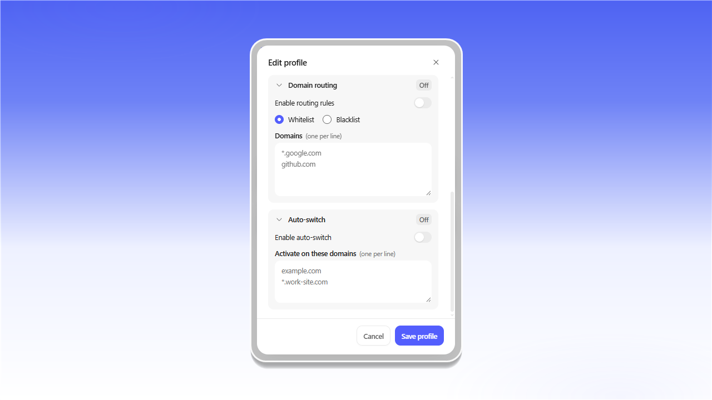
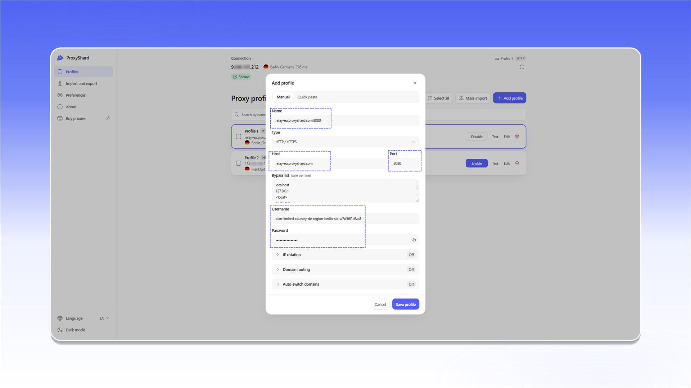

# ProxyShard Extension

<mark style="color:purple;">**ProxyShard – Smart Proxy Manager**</mark> 是 ProxyShard 官方浏览器扩展，支持 Chrome、Mozilla Firefox 以及 Edge、Opera、Brave、Yandex 等 Chromium 浏览器。您可以直接在浏览器中添加、测试和切换代理。

#### 扩展功能

* 可保存不限数量的代理配置
* 所有受支持的浏览器均可使用 HTTP / HTTPS
* Mozilla Firefox 支持 SOCKS5
* 检查连接状态、IP 地址、国家/地区和延迟
* 按时间间隔或快捷键轮换移动代理 IP
* 按域名设置路由规则并自动切换配置
* WebRTC 泄漏防护和 p0f TCP 指纹检查
* 导入和导出配置
* 提供英语、俄语、乌克兰语和中文界面

<figure>
  <picture>
    <source srcset="../.gitbook/assets/proxyshard-extension-popup-overview_black.png" media="(prefers-color-scheme: dark)">
    
  </picture>
  <figcaption>
主窗口和已保存的代理配置
</figcaption>
</figure>

## 安装扩展程序

该扩展可从官方 Chrome Web Store 和 Firefox Add-ons 安装。Chrome Web Store 版本也适用于 Edge、Opera、Brave 及其他 Chromium 浏览器。

### Chrome、Edge、Opera、Brave、Yandex 及其他 Chromium 浏览器



### Mozilla Firefox



安装后，打开地址栏右侧的 `Extensions` 菜单，点击图钉图标固定 `ProxyShard – Smart Proxy Manager`。

<figure>
  <picture>
    <source srcset="../.gitbook/assets/proxyshard-extension-pin_black.png" media="(prefers-color-scheme: dark)">
    
  </picture>
  <figcaption>
打开 Extensions 菜单并固定扩展
</figcaption>
</figure>


**Chromium 浏览器中的 SOCKS5 限制**

Chrome 及其他 Chromium 浏览器不支持 Manifest V3 扩展通过用户名和密码验证 SOCKS5 代理。

SOCKS5 只能在无需凭据或通过 IP 白名单验证时使用。代理需要用户名和密码时，请选择 HTTP / HTTPS。



**Mozilla Firefox 中的 SOCKS5**

Mozilla Firefox 版 ProxyShard Extension 支持带验证的 SOCKS5，因此可以直接使用这类配置。


## 设置住宅代理

1. 在 [Residential proxy](https://dashboard.proxyshard.com/en/residential-main) 页面打开订单。
2. 选择国家/地区、区域、会话类型、协议及其他参数，然后点击 `Generate proxy`。
3. 在 `Proxy List` 中选择所需格式，然后点击 `Copy all`。

<figure>
  <picture>
    <source srcset="../.gitbook/assets/proxyshard-extension-residential-generate_black.png" media="(prefers-color-scheme: dark)">
    
  </picture>
  <figcaption>
住宅代理设置和 Proxy List
</figcaption>
</figure>

4. 打开已固定的 ProxyShard 扩展。
5. 将 `ip:port:login:password` 格式的代理字符串粘贴到底部输入框，然后点击 `Add`。

<figure>
  <picture>
    <source srcset="../.gitbook/assets/proxyshard-extension-add-proxy-string_black.png" media="(prefers-color-scheme: dark)">
    
  </picture>
  <figcaption>
粘贴连接字符串并点击 Add
</figcaption>
</figure>

6. 新配置会显示在列表中。打开其 `...` 菜单，选择 `Test connection`，测试成功后点击 `Enable`。

<figure>
  <picture>
    <source srcset="../.gitbook/assets/proxyshard-extension-profile-actions_black.png" media="(prefers-color-scheme: dark)">
    
  </picture>
  <figcaption>
测试、编辑和删除配置的操作菜单
</figcaption>
</figure>

## 设置数据中心或 ISP 代理

1. 在控制面板中打开数据中心或 ISP 代理订单。
2. 在 `Proxy List` 中选择协议和格式，然后点击 `Copy all`。

<figure>
  <picture>
    <source srcset="../.gitbook/assets/proxyshard-extension-datacenter-proxy-list_black.png" media="(prefers-color-scheme: dark)">
    
  </picture>
  <figcaption>
从 Proxy List 复制连接字符串
</figcaption>
</figure>

3. 打开扩展，将代理字符串粘贴到底部输入框，然后点击 `Add`。

<figure>
  <picture>
    <source srcset="../.gitbook/assets/proxyshard-extension-add-datacenter-proxy_black.png" media="(prefers-color-scheme: dark)">
    
  </picture>
  <figcaption>
添加数据中心或 ISP 代理
</figcaption>
</figure>

4. 打开新配置的 `...` 菜单并选择 `Test connection`。
5. 测试成功后，点击 `Enable`。启用其他配置时，当前连接会自动切换。

<figure>
  <picture>
    <source srcset="../.gitbook/assets/proxyshard-extension-profile-switch_black.png" media="(prefers-color-scheme: dark)">
    
  </picture>
  <figcaption>
测试并启用新配置
</figcaption>
</figure>

## 移动代理 IP 轮换

打开配置的 `...` 菜单，点击 `Edit`，然后展开 `IP rotation`。

* `Enable IP rotation` 用于开启自动 IP 轮换。
* 在 `Rotation URL` 中粘贴移动代理订单内的 IP 更换链接。
* 在 `Trigger` 中选择 `Hotkey` 或 `Interval`。
* 使用 `Hotkey` 时，请设置快捷键，例如 `Shift+F2`。如需在 `chrome://` 内部页面中使用，请在 `chrome://extensions/shortcuts` 页面单独设置。
* 使用 `Interval` 时，请设置两次 IP 更换请求之间的时间间隔。
* `Track IP history (detects duplicate IPs)` 用于检测是否再次分配了相同的 IP 地址。

点击 `Save profile` 保存设置。

<figure>
  <picture>
    <source srcset="../.gitbook/assets/proxyshard-extension-edit-profile-ip-rotation_black.png" media="(prefers-color-scheme: dark)">
    
  </picture>
  <figcaption>
通过快捷键或时间间隔轮换 IP
</figcaption>
</figure>

## 域名路由和自动切换

配置编辑窗口包含 `Domain routing` 和 `Auto-switch` 两个部分。

### Domain routing

此部分用于设置特定域名的代理路由规则。

* `Enable routing rules` 用于开启域名路由规则。
* `Whitelist` 仅让指定域名通过代理连接。
* `Blacklist` 排除指定域名，不让其通过代理连接。
* 在 `Domains` 中每行输入一个域名。需要包含子域名时，请在域名前添加 `*.` 通配符，例如 `*.google.com`。

### Auto-switch

打开指定网站时，此功能会自动启用所选配置。

* `Enable auto-switch` 用于开启自动切换。
* 在 `Activate on these domains` 中每行输入一个域名，例如 `example.com` 或 `*.work-site.com`。

点击 `Save profile` 保存更改，或点击 `Cancel` 关闭窗口且不保存。

<figure>
  <picture>
    <source srcset="../.gitbook/assets/proxyshard-extension-edit-profile-routing_black.png" media="(prefers-color-scheme: dark)">
    
  </picture>
  <figcaption>
域名路由和配置自动切换
</figcaption>
</figure>

## 手动添加配置

1. 点击扩展主窗口中的齿轮图标，然后打开 `Profiles`。
2. 点击 `+ Add profile`，再选择 `Manual` 选项卡。
3. 填写以下字段：
   * `Name` - 配置名称；
   * `Type` - 连接类型；
   * `Host` 和 `Port` - 代理服务器地址和端口；
   * `Bypass list` - 需要直连的地址，每行一个；
   * `Username` 和 `Password` - 验证凭据。
4. 如有需要，可设置 `IP rotation`、`Domain routing` 和 `Auto-switch domains`。
5. 点击 `Save profile`。

如需快速添加完整的代理字符串，请使用 `Quick paste` 选项卡。

<figure>
  <picture>
    <source srcset="../.gitbook/assets/proxyshard-extension-options-add-profile_black.png" media="(prefers-color-scheme: dark)">
    
  </picture>
  <figcaption>
Manual 选项卡中的 Add profile 表单
</figcaption>
</figure>

## 导入和导出配置

通过 `Import and export` 可以备份配置，并在需要时恢复。

* `Export profiles` 将所有配置保存到 JSON 文件。点击 `Export JSON`，然后将文件保存在安全位置。
* `Import from JSON` 从之前导出的文件恢复配置。点击 `Import JSON` 并选择备份文件。


备份文件可能包含代理地址和验证凭据。请勿将其提供给不受信任的人员。


<figure>
  <picture>
    <source srcset="../.gitbook/assets/proxyshard-extension-options-import-export_black.png" media="(prefers-color-scheme: dark)">
    
  </picture>
  <figcaption>
备份和恢复代理配置
</figcaption>
</figure>

## 其他设置

`Preferences` 中包含以下设置：

* `Show IP widget in popup` 在扩展弹窗顶部显示当前 IP 地址和位置。
* `Show badge on the toolbar icon` 在扩展图标上显示连接状态标记。
* `Context menu` 将代理配置切换功能添加到浏览器右键菜单。
* `Auto-switch by domain` 允许扩展为已配置的域名自动启用相应配置。
* `WebRTC leak protection` 有助于防止 WebRTC 暴露真实 IP 地址。启用后，部分依赖 WebRTC 的服务可能无法正常工作。详情请参阅 [UDP 与 WebRTC](about-udp/README.md)。
* `Proxy fingerprint check (p0f)` 将 User-Agent 中的操作系统与 TCP 指纹进行比较。两者不一致时，网站可能会识别出您正在使用代理。详情请参阅[使用 p0f 修改操作系统指纹](p0f-spoofing.md)。
* `IP checker` 用于选择检测 IP 地址和位置的服务。在 `Auto (fallback)` 模式下，扩展会依次尝试可用服务，直到其中一个成功响应。

更改设置后，点击 `Save preferences`。

<figure>
  <picture>
    <source srcset="../.gitbook/assets/proxyshard-extension-options-preferences_black.png" media="(prefers-color-scheme: dark)">
    
  </picture>
  <figcaption>
扩展程序的其他设置
</figcaption>
</figure>


ProxyShard Extension 已可使用。您可以从扩展主窗口启用和切换已保存的配置。

