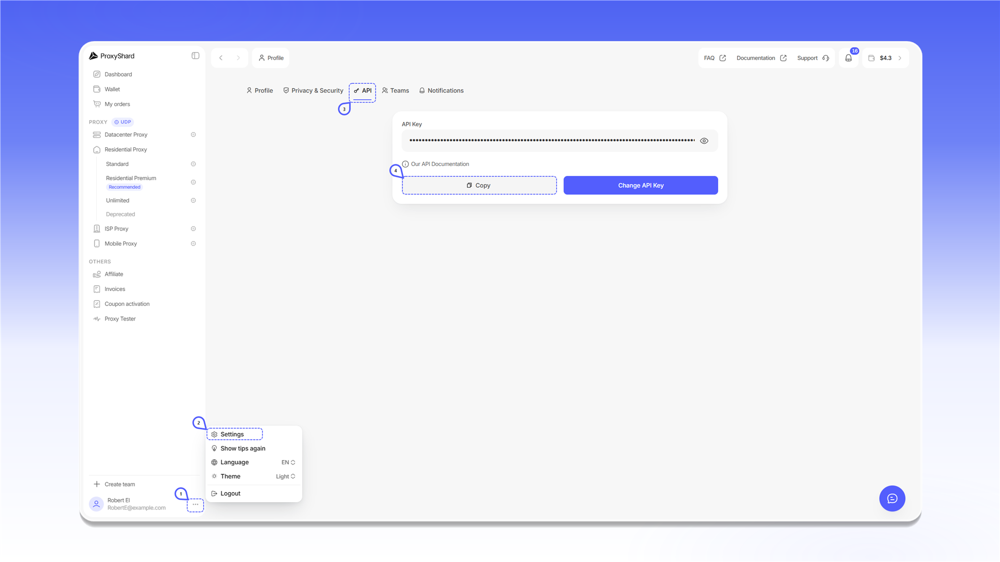

# 开始使用

ProxyShard API 可用于获取个人资料和订单信息、管理代理，以及通过应用程序或脚本执行其他操作。

## 获取 API 密钥

1. 点击左下角个人资料旁的三点按钮。
2. 选择 `Settings`。
3. 打开 `API` 选项卡。
4. 点击 `Copy` 复制密钥。

<figure>
  <picture>
    <source srcset="../.gitbook/assets/proxyshard-api-key_black.png" media="(prefers-color-scheme: dark)">
    
  </picture>
</figure>


请勿公开 API 密钥或将其提供给他人。`Change API Key` 会创建新密钥。更换后，请更新所有脚本和集成中使用的密钥。


## 身份验证

API 基础地址：`https://user-api.proxyshard.com`。

调用需要身份验证的方法时，请在请求标头中传递 API 密钥：

```http
Authorization: Bearer <API_KEY>
```

## OpenAPI 规范


下载 ProxyShard OpenAPI 规范

