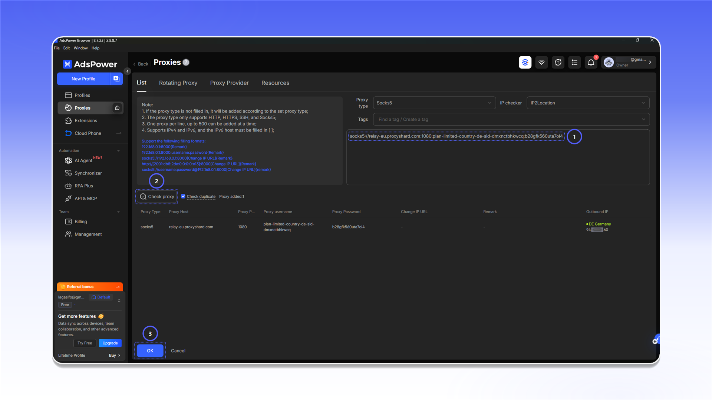

# AdsPower


AdsPower 不支持 UDP 代理。如需使用 UDP，请选择 [Vision Browser](vision-browser.md)。


## 添加代理

打开 `Proxies`，点击 `Add Proxy`。

<figure>
  <picture>
    <source srcset="../../.gitbook/assets/adspower-proxies-add-proxy_black.png" media="(prefers-color-scheme: dark)">
    
  </picture>
</figure>

1. 从对应订单的 `Proxy List` 中复制连接字符串，并粘贴到表单中。
2. 点击 `Check proxy`。
3. 检查成功后点击 `OK`。

<figure>
  <picture>
    <source srcset="../../.gitbook/assets/adspower-add-proxy-form_black.png" media="(prefers-color-scheme: dark)">
    
  </picture>
</figure>


如需了解连接信息的位置，请参阅[通用配置说明](../getting-started.md)。


如果检查失败，请核对用户名、密码和协议。还可以使用 [Proxy Tester](../../our-products/proxy-tester.md) 检测连接。

<figure>
  <picture>
    <source srcset="../../.gitbook/assets/adspower-proxy-tester-result_black.png" media="(prefers-color-scheme: dark)">
    
  </picture>
</figure>

## 将代理分配给配置

打开 `Profiles`，点击 `New Profile`。

<figure>
  <picture>
    <source srcset="../../.gitbook/assets/adspower-profiles-new-profile_black.png" media="(prefers-color-scheme: dark)">
    
  </picture>
</figure>

在配置设置中，从 `Saved Proxies` 选择已添加的服务器，完成检测并保存配置。

<figure>
  <picture>
    <source srcset="../../.gitbook/assets/adspower-new-profile-saved-proxy_black.png" media="(prefers-color-scheme: dark)">
    
  </picture>
</figure>
