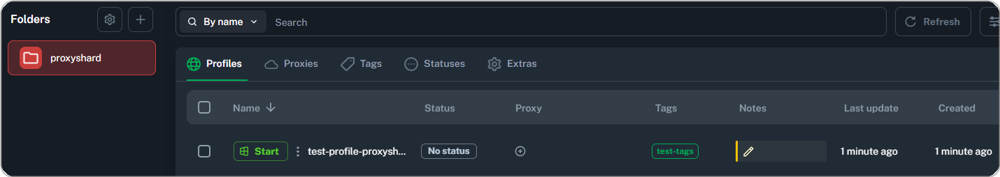
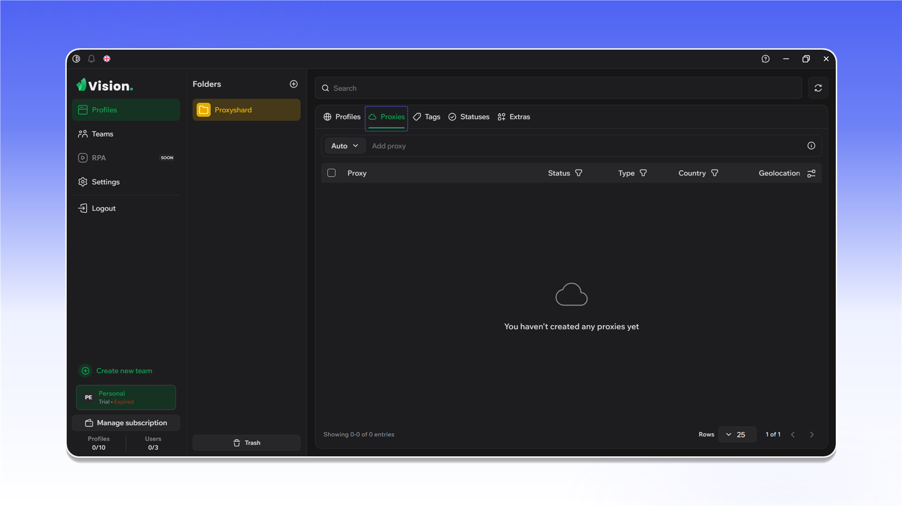
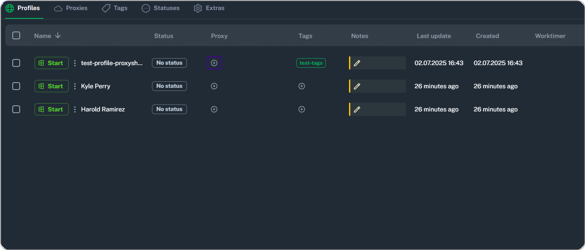
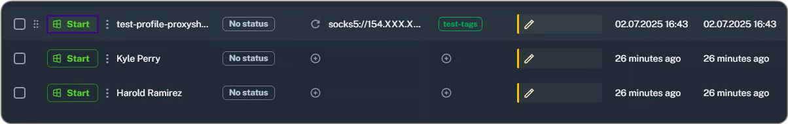
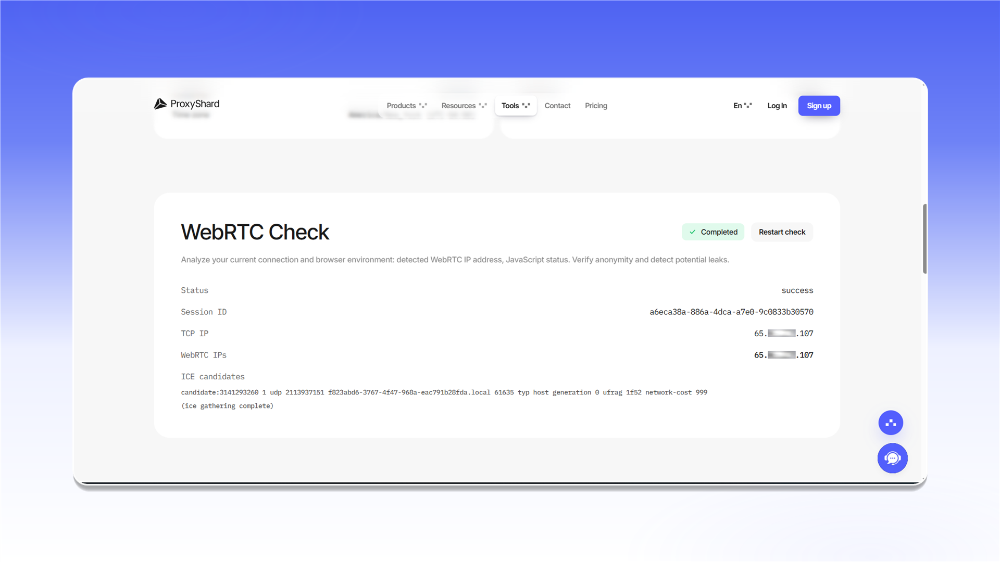

# Vision Browser


Vision Browser 支持通过 SOCKS5 代理传输 TCP 和 UDP 流量。


## 安装和注册

打开 [Vision Browser 网站](https://browser.vision/r/ecf2408f-02de-4e4f-bc24-be368ac32325)，下载并安装应用。

<figure>
  <picture>
    <source srcset="../../.gitbook/assets/vision-website-download_black.png" media="(prefers-color-scheme: dark)">
    
  </picture>
</figure>

创建账号。登录应用时需要使用这些信息。

<figure>
  <picture>
    <source srcset="../../.gitbook/assets/vision-sign-up_black.png" media="(prefers-color-scheme: dark)">
    
  </picture>
</figure>

购买套餐时，可使用优惠码 `PROXYSHARD` 享受 20% 折扣。

<figure>
  <picture>
    <source srcset="../../.gitbook/assets/vision-plan-promo-code_black.png" media="(prefers-color-scheme: dark)">
    
  </picture>
</figure>

## 创建第一个配置

1. 打开 `Profiles`。
2. 进入 `Folders`，点击 `Create folder`。

<figure>
  <picture>
    <source srcset="../../.gitbook/assets/vision-folders-create_black.png" media="(prefers-color-scheme: dark)">
    
  </picture>
</figure>

输入文件夹名称并保存。

<figure>
  <picture>
    <source srcset="../../.gitbook/assets/vision-folder-create-form_black.png" media="(prefers-color-scheme: dark)">
    
  </picture>
</figure>

在新文件夹中点击 `Create profile`。

<figure>
  <picture>
    <source srcset="../../.gitbook/assets/vision-profiles-create-profile_black.png" media="(prefers-color-scheme: dark)">
    
  </picture>
</figure>

在 ShardX 面板中生成一个 SOCKS5 代理，并复制连接信息。

<figure>
  <picture>
    <source srcset="../../.gitbook/assets/vision-residential-generate-single_black.png" media="(prefers-color-scheme: dark)">
    
  </picture>
</figure>

在 Vision 配置设置中打开 `SOCKS` 选项卡，填写代理信息，检测连接，然后点击 `Save`。

<figure>
  <picture>
    <source srcset="../../.gitbook/assets/vision-create-profile-socks_black.png" media="(prefers-color-scheme: dark)">
    
  </picture>
</figure>

<figure><figcaption></figcaption></figure>

## 添加代理列表

打开 `Proxies` 选项卡，点击 `Add proxy`。

<figure>
  <picture>
    <source srcset="../../.gitbook/assets/vision-proxies-add-proxy_black.png" media="(prefers-color-scheme: dark)">
    
  </picture>
</figure>

在 ShardX 面板中生成 SOCKS5 代理列表并复制。

<figure>
  <picture>
    <source srcset="../../.gitbook/assets/vision-residential-generate-list_black.png" media="(prefers-color-scheme: dark)">
    
  </picture>
</figure>

将列表粘贴到添加字段中。导入后，请确认各连接显示 `Online`。

<figure>
  <picture>
    <source srcset="../../.gitbook/assets/vision-proxies-imported-list_black.png" media="(prefers-color-scheme: dark)">
    
  </picture>
</figure>

要为现有配置分配代理，请点击 `Proxy` 列中的图标。

<figure><figcaption></figcaption></figure>

选择 `Select proxy`，指定连接并执行检测。

<figure><figcaption></figcaption></figure>

保存后，代理会显示在配置所在行。

<figure><figcaption></figcaption></figure>

## 检查 WebRTC

启动配置并打开 [ShardX IP Checker](https://proxyshard.com/ip-checker)。TCP 和 WebRTC 地址应保持一致。

<figure>
  <picture>
    <source srcset="../../.gitbook/assets/vision-webrtc-check_black.png" media="(prefers-color-scheme: dark)">
    
  </picture>
</figure>
