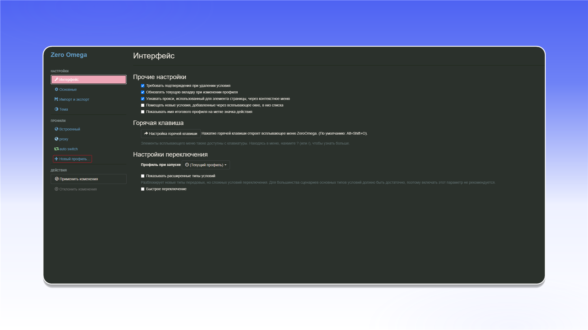

# ZeroOmega

## 安装 ZeroOmega


ZeroOmega 仅支持 TCP 流量。如需使用 UDP，请改用 [Vision Browser](../../antidetect-browsers/vision-browser.md)。


从 Chrome Web Store 安装 [ZeroOmega](https://chromewebstore.google.com/detail/pfnededegaaopdmhkdmcofjmoldfiped)。



安装完成后，打开扩展程序菜单，将 ZeroOmega 固定到浏览器工具栏。

<figure><figcaption></figcaption></figure>

打开 ZeroOmega，然后选择 `Параметры`。

<figure>
  <picture>
    <source srcset="../../../.gitbook/assets/chrome-zeroomega-open-options_black.png" media="(prefers-color-scheme: dark)">
    
  </picture>
</figure>

## 配置代理

在配置文件区域点击 `Новый профиль...`。

<figure>
  <picture>
    <source srcset="../../../.gitbook/assets/chrome-zeroomega-new-profile_black.png" media="(prefers-color-scheme: dark)">
    
  </picture>
</figure>

输入配置文件名称，选择 `Профиль прокси`，然后点击 `Создать`。

<figure>
  <picture>
    <source srcset="../../../.gitbook/assets/chrome-zeroomega-new-profile-dialog_black.png" media="(prefers-color-scheme: dark)">
    
  </picture>
</figure>

在配置文件设置中选择协议，并填写订单 `Proxy List` 中的服务器地址和端口。点击锁形图标即可添加用户名和密码。


数据格式和订单示例请参阅[开始使用](../../getting-started.md)。


<figure>
  <picture>
    <source srcset="../../../.gitbook/assets/chrome-zeroomega-proxy-server_black.png" media="(prefers-color-scheme: dark)">
    
  </picture>
</figure>

输入代理用户名和密码，然后点击 `Сохранить изменения`。

<figure>
  <picture>
    <source srcset="../../../.gitbook/assets/chrome-zeroomega-proxy-auth_black.png" media="(prefers-color-scheme: dark)">
    
  </picture>
</figure>

点击 `Применить изменения` 保存配置文件。

<figure>
  <picture>
    <source srcset="../../../.gitbook/assets/chrome-zeroomega-apply-changes_black.png" media="(prefers-color-scheme: dark)">
    
  </picture>
</figure>

从浏览器工具栏打开 ZeroOmega，然后选择刚才创建的配置文件。

<figure><figcaption></figcaption></figure>

代理现已连接，可以在 Chrome 中使用。
