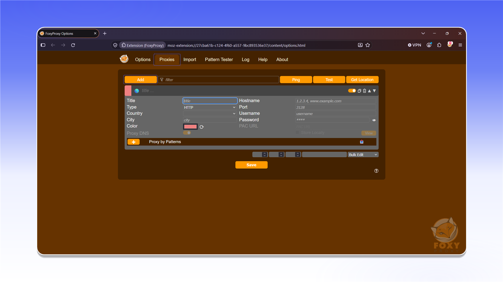

# FoxyProxy

## 安装 FoxyProxy


FoxyProxy 仅支持 TCP 流量。


从 Firefox Add-ons 安装 [FoxyProxy Standard](https://addons.mozilla.org/firefox/addon/foxyproxy-standard/)。



<figure>
  <picture>
    <source srcset="../../../.gitbook/assets/foxyproxy-addon-page_black.png" media="(prefers-color-scheme: dark)">
    
  </picture>
</figure>

安装完成后，打开 FoxyProxy 并进入扩展程序设置。

<figure>
  <picture>
    <source srcset="../../../.gitbook/assets/foxyproxy-options-popup-disable_black.png" media="(prefers-color-scheme: dark)">
    
  </picture>
</figure>

## 配置代理

打开 `Proxies`，然后点击 `Add`。

<figure>
  <picture>
    <source srcset="../../../.gitbook/assets/foxyproxy-add-proxy-form_black.png" media="(prefers-color-scheme: dark)">
    
  </picture>
</figure>


数据格式和订单示例请参阅[开始使用](../../getting-started.md)。


在 `Title` 中输入配置文件名称。选择代理类型，然后使用订单 `Proxy List` 中的数据填写 `Hostname`、`Port`、`Username` 和 `Password`。点击 `Save`。

<figure>
  <picture>
    <source srcset="../../../.gitbook/assets/foxyproxy-proxy-config-filled_black.png" media="(prefers-color-scheme: dark)">
    
  </picture>
</figure>

## 连接代理

打开 FoxyProxy，然后选择刚才创建的配置文件。

<figure>
  <picture>
    <source srcset="../../../.gitbook/assets/foxyproxy-options-popup-proxyshard_black.png" media="(prefers-color-scheme: dark)">
    
  </picture>
</figure>

代理现已连接，可以在 Mozilla Firefox 中使用。
