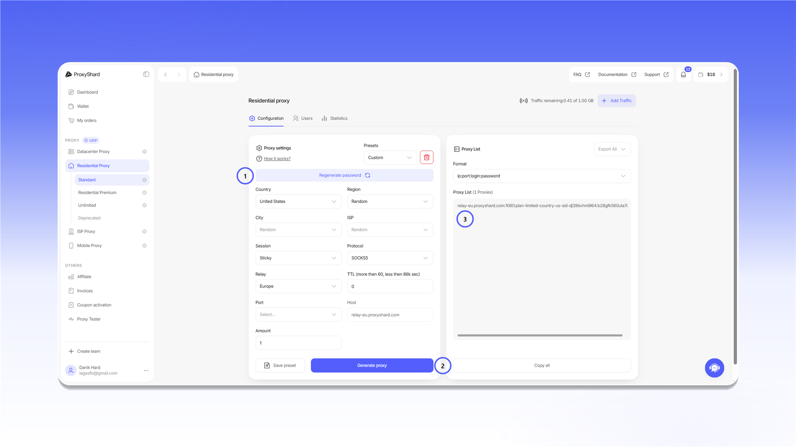
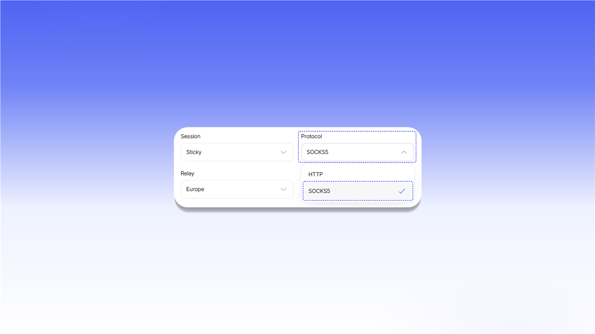

# 配置说明

开始配置应用前，请打开对应的[订单](https://dashboard.proxyshard.com/products)并准备好连接信息。


以下示例使用 `SOCKS5`。如果应用仅支持 HTTP，请在订单设置中选择 `HTTP`，并使用对应端口。


## 住宅代理

1. 在 `Proxy settings` 中选择国家，并设置 `Session`、`Relay` 和 `Protocol`。
2. 点击 `Generate proxy`。
3. 从 `Proxy List` 中复制生成的连接字符串。

<figure>
  <picture>
    <source srcset="../.gitbook/assets/residential-proxy-setup_black.png" media="(prefers-color-scheme: dark)">
    
  </picture>
</figure>

## 数据中心和 ISP 代理

打开订单，从 `Proxy List` 中复制连接字符串。

<figure>
  <picture>
    <source srcset="../.gitbook/assets/static-proxy-setup_black.png" media="(prefers-color-scheme: dark)">
    
  </picture>
</figure>

## 连接字符串格式

标准格式为 `server:port:login:password`。

<figure>
  <picture>
    <source srcset="../.gitbook/assets/proxy-format-breakdown_black.png" media="(prefers-color-scheme: dark)">
    
  </picture>
</figure>

| 字段 | 说明 |
|---|---|
| `Server / Host` | 代理服务器的 IP 地址或域名 |
| `Port` | 连接端口 |
| `Login` | 用户名。对于住宅代理，其中还可能包含定位参数 |
| `Password` | 访问密码 |

如果应用不支持粘贴完整连接字符串，请分别填写这些字段。

## 选择协议

对于数据中心和 ISP 代理，请在 `Proxy List` 中切换格式。

<figure>
  <picture>
    <source srcset="../.gitbook/assets/proxy-protocol-toggle_black.png" media="(prefers-color-scheme: dark)">
    
  </picture>
</figure>

对于住宅代理，请在生成连接字符串前，在 `Protocol` 字段中选择协议。

<figure>
  <picture>
    <source srcset="../.gitbook/assets/proxy-protocol-select_black.png" media="(prefers-color-scheme: dark)">
    
  </picture>
</figure>

移动代理可在分配的端口上接受 HTTP 和 SOCKS5 连接，无需在订单中额外切换格式。
