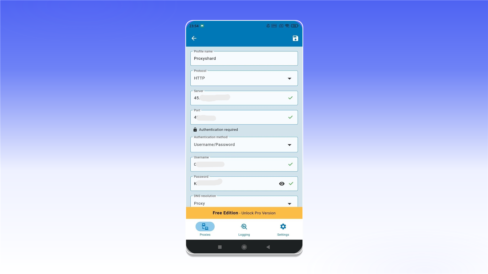
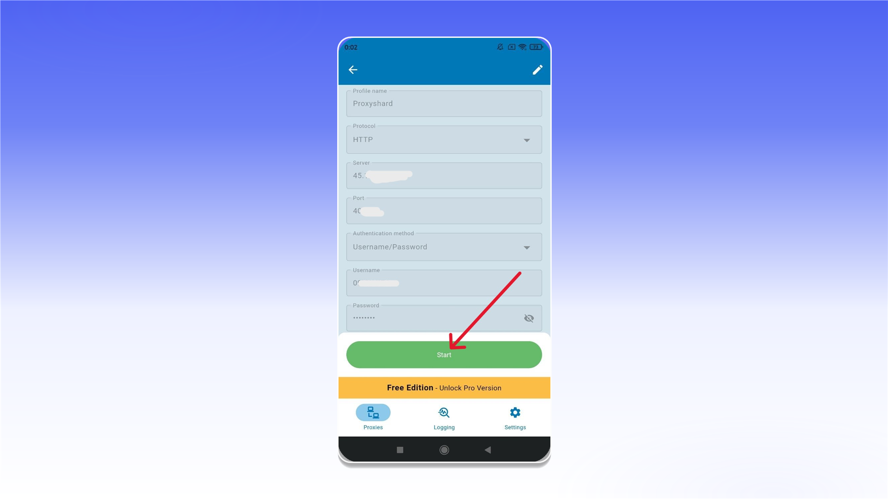

# Super Proxy

## 配置 Super Proxy

从 Google Play 安装 Super Proxy。



## 创建配置文件

打开应用，然后点击 `Add proxy`。

<figure>
  <picture>
    <source srcset="../../.gitbook/assets/super-proxy-android-add-proxy_black.png" media="(prefers-color-scheme: dark)">
    
  </picture>
</figure>

在 `Profile name` 中输入配置文件名称，选择协议，并使用订单 `Proxy List` 中的数据填写 `Server`、`Port`、`Username` 和 `Password`。然后保存配置文件。

<figure>
  <picture>
    <source srcset="../../.gitbook/assets/super-proxy-android-proxy-form_black.png" media="(prefers-color-scheme: dark)">
    
  </picture>
</figure>


数据格式和订单示例请参阅[开始使用](../getting-started.md)。


选择刚才创建的配置文件，然后启动连接。

<figure>
  <picture>
    <source srcset="../../.gitbook/assets/super-proxy-android-start_black.png" media="(prefers-color-scheme: dark)">
    
  </picture>
</figure>

代理现已连接，可以在 Super Proxy 中使用。
