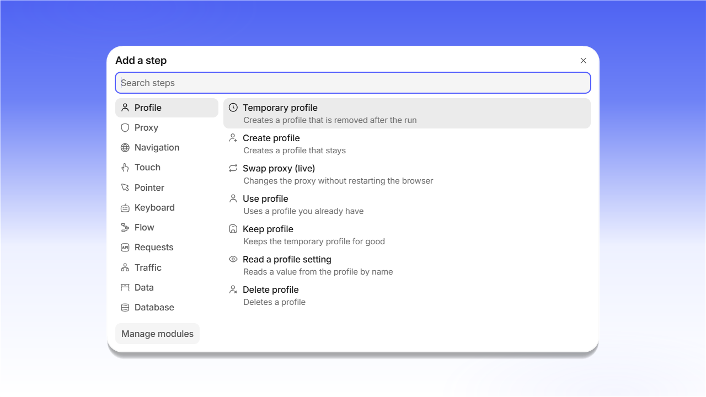

# Automation

<mark style="color:purple;">**Automation**</mark> 用于构建由一系列操作组成的场景，例如打开页面、点击元素、输入文本、更换代理等。点击 <mark style="color:purple;">**+ New project**</mark> 创建场景。也可以通过 <mark style="color:purple;">**Import**</mark> 导入现成的项目。

<figure>
  <picture>
    <source srcset="../../.gitbook/assets/shardbrowser-automation-empty_black.png" media="(prefers-color-scheme: dark)">
    
  </picture>
  <figcaption>Automation 页面</figcaption>
</figure>

场景由 <mark style="color:purple;">**Add a step**</mark> 窗口中的步骤组成。步骤分为以下几组：<mark style="color:purple;">**Profile**</mark>、<mark style="color:purple;">**Proxy**</mark>、<mark style="color:purple;">**Navigation**</mark>、<mark style="color:purple;">**Touch**</mark>、<mark style="color:purple;">**Pointer**</mark>、<mark style="color:purple;">**Keyboard**</mark>、<mark style="color:purple;">**Flow**</mark>、<mark style="color:purple;">**Requests**</mark>、<mark style="color:purple;">**Traffic**</mark>、<mark style="color:purple;">**Data**</mark> 和 <mark style="color:purple;">**Database**</mark>。可以通过搜索查找所需步骤。

<figure>
  <picture>
    <source srcset="../../.gitbook/assets/shardbrowser-automation-add-step_black.png" media="(prefers-color-scheme: dark)">
    
  </picture>
  <figcaption>Add a step 窗口</figcaption>
</figure>

例如，<mark style="color:purple;">**Profile**</mark> 组中包含以下步骤：

| 步骤                   | 作用                         |
| ---------------------- | ---------------------------- |
| Temporary profile      | 创建运行结束后即删除的配置文件 |
| Create profile         | 创建永久配置文件             |
| Swap proxy (live)      | 不重启浏览器即可更换代理     |
| Use profile            | 使用已有的配置文件           |
| Keep profile           | 永久保留临时配置文件         |
| Read a profile setting | 按名称读取配置文件的设置值   |
| Delete profile         | 删除配置文件                 |

<mark style="color:purple;">**Manage modules**</mark> 用于管理已接入的步骤模块。


也可以通过本地 HTTP API（`127.0.0.1:40325`）用自己的代码控制配置文件。侧边菜单底部会显示 <mark style="color:purple;">**API on**</mark> 状态。

