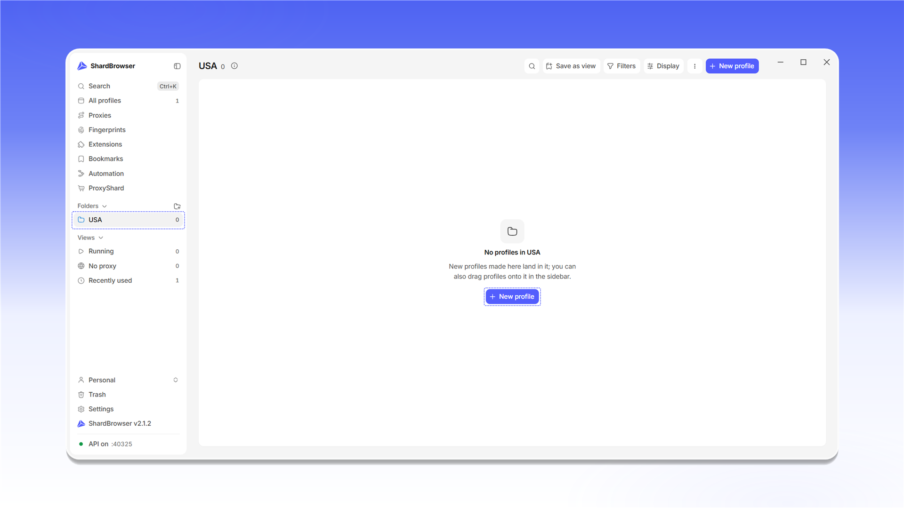

# Folders

文件夹可以帮助你按项目、国家或团队整理配置文件。文件夹列表位于侧边菜单的 <mark style="color:purple;">**Folders**</mark> 区块中。要创建文件夹，请点击 <mark style="color:purple;">**Folders**</mark> 旁边的 <mark style="color:purple;">**+**</mark> 图标。

<figure>
  <picture>
    <source srcset="../../.gitbook/assets/shardbrowser-folders-new_black.png" media="(prefers-color-scheme: dark)">
    
  </picture>
  <figcaption>在侧边菜单中创建文件夹</figcaption>
</figure>

在 <mark style="color:purple;">**New folder**</mark> 窗口中输入名称，选择颜色和图标，然后点击 <mark style="color:purple;">**Create**</mark>。

<figure>
  <picture>
    <source srcset="../../.gitbook/assets/shardbrowser-folder-create_black.png" media="(prefers-color-scheme: dark)">
    
  </picture>
  <figcaption>输入文件夹名称并选择颜色和图标</figcaption>
</figure>

文件夹会出现在侧边菜单中。在文件夹内创建的新配置文件（<mark style="color:purple;">**+ New profile**</mark>）会直接归入该文件夹。可以通过 <mark style="color:purple;">**Save as view**</mark> 将当前文件夹筛选保存到 <mark style="color:purple;">**Views**</mark>。

<figure>
  <picture>
    <source srcset="../../.gitbook/assets/shardbrowser-folder-empty_black.png" media="(prefers-color-scheme: dark)">
    
  </picture>
  <figcaption>空文件夹</figcaption>
</figure>

要移动已有的配置文件，请打开配置文件菜单（<mark style="color:purple;">**⋮**</mark>）并选择 <mark style="color:purple;">**Move to folder**</mark>（快捷键 `M`）。也可以把配置文件拖到侧边菜单中的文件夹上。

<figure>
  <picture>
    <source srcset="../../.gitbook/assets/shardbrowser-profile-move-to-folder_black.png" media="(prefers-color-scheme: dark)">
    
  </picture>
  <figcaption>配置文件菜单：Move to folder</figcaption>
</figure>
