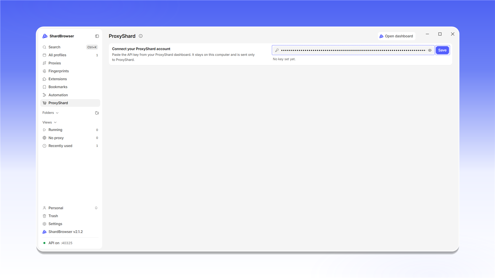

# ShardX Dashboard

<mark style="color:purple;">**ShardX**</mark> 页面将你的 [ShardX](https://proxyshard.com) 账户接入应用：余额、流量、订单和购买代理都可以直接在 ShardBrowser 中完成。

要连接账户，请从 [ShardX 个人中心的 API 设置](https://dashboard.shardx.com/en/profile?tab=api-key)复制 API 密钥，并粘贴到 <mark style="color:purple;">**Connect your ShardX account**</mark> 区块的输入框中。

<figure>
  <picture>
    <source srcset="../../.gitbook/assets/shardbrowser-proxyshard-connect_black.png" media="(prefers-color-scheme: dark)">
    
  </picture>
  <figcaption>ShardX 页面</figcaption>
</figure>

点击 <mark style="color:purple;">**Save**</mark>。


API 密钥保存在您的计算机上，并且只会发送给 ShardX。请勿与他人分享。


<figure>
  <picture>
    <source srcset="../../.gitbook/assets/shardbrowser-proxyshard-api-key_black.png" media="(prefers-color-scheme: dark)">
    
  </picture>
  <figcaption>粘贴 API 密钥并点击 Save</figcaption>
</figure>

连接后会打开账户面板：

- **Residential**：住宅代理的剩余流量，以及 <mark style="color:purple;">**Buy traffic**</mark> 和 <mark style="color:purple;">**Generate proxies**</mark> 按钮
- **Balance**：账户余额
- **Active orders**：有效订单数量
- **Usage**：所选时间段内的流量使用图表和请求数，以及失败的请求（<mark style="color:purple;">**Failed requests**</mark>）
- **Orders**：订单列表，包含产品、订单号、到期时间和标签

<mark style="color:purple;">**Buy proxies**</mark> 用于购买代理，<mark style="color:purple;">**Open dashboard**</mark> 用于打开网站上的个人中心。

<figure>
  <picture>
    <source srcset="../../.gitbook/assets/shardbrowser-proxyshard-dashboard_black.png" media="(prefers-color-scheme: dark)">
    
  </picture>
  <figcaption>ShardX 账户面板</figcaption>
</figure>
