# Team server


团队服务器让多人共同使用 ShardBrowser 的共享配置文件。服务器由您自己运行，例如部署在 VPS 上：团队的配置文件存储在服务器上，成员的启动器通过邀请链接连接到服务器。管理员决定每位成员可以访问哪些文件夹、执行哪些操作。


## 准备工作

* 所有成员的电脑上安装 ShardBrowser 2.1.2 或更高版本。
* 一台成员可以通过网络访问的服务器，例如可通过 SSH 以 `root` 或具有 `sudo` 权限的用户登录的 Ubuntu VPS。
* 服务器上开放入站端口 <mark style="color:purple;">`8787`</mark>（TCP）。

---

## 在 ShardBrowser 中创建团队

在左下角点击工作空间切换器 <mark style="color:purple;">**Personal**</mark>，然后选择 <mark style="color:purple;">**Create a team...**</mark>。

<figure>
  <picture>
    <source srcset="../../.gitbook/assets/shardbrowser-team-workspace-menu_black.png" media="(prefers-color-scheme: dark)">
    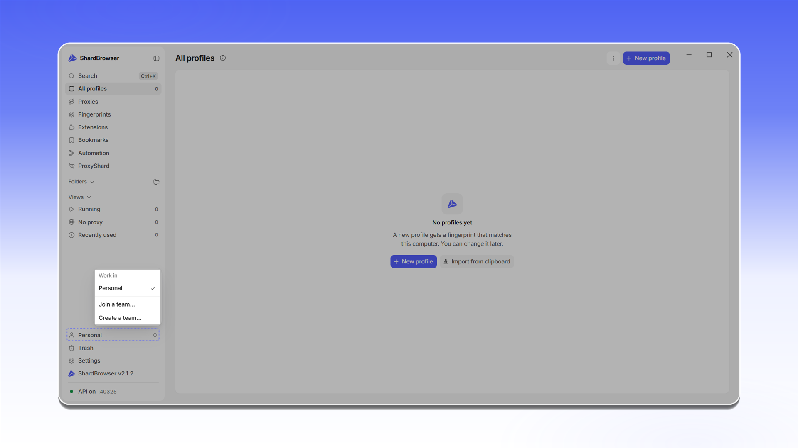
  </picture>
  <figcaption>工作空间菜单："Create a team..."</figcaption>
</figure>

将打开 <mark style="color:purple;">**Create a team**</mark> 窗口。在 <mark style="color:purple;">**Team name**</mark> 字段中输入团队名称。服务器仅在首次启动时读取该名称，之后可以在团队页面中重命名。

<figure>
  <picture>
    <source srcset="../../.gitbook/assets/shardbrowser-team-create-dialog_black.png" media="(prefers-color-scheme: dark)">
    
  </picture>
  <figcaption>Create a team 窗口：输入团队名称</figcaption>
</figure>

请不要关闭此窗口：后续还需要用到服务器启动命令和连接字段。

---

## 在 VPS 上安装 Docker 和团队服务器

通过 SSH 连接到服务器，并使用官方脚本安装 Docker：

```bash
curl -fsSL https://get.docker.com -o get-docker.sh
sudo sh get-docker.sh
```

脚本会自动添加 Docker 软件源、安装软件包并启动服务。最后会输出 Docker Engine 客户端和服务端的版本。

<figure>
  <picture>
    <source srcset="../../.gitbook/assets/shardbrowser-team-vps-docker-install_black.png" media="(prefers-color-scheme: dark)">
    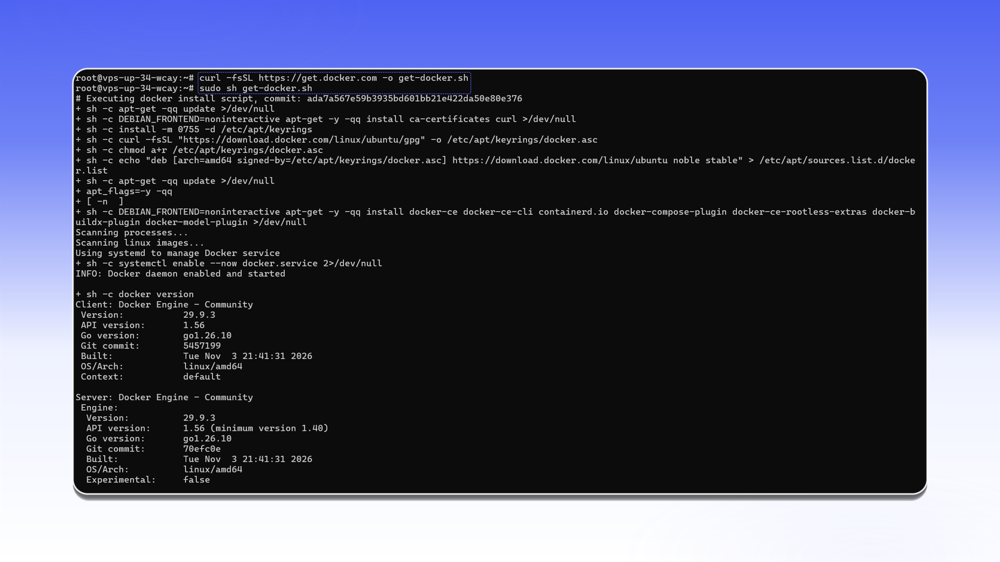
  </picture>
  <figcaption>使用 get-docker.sh 安装 Docker</figcaption>
</figure>

如果最后出现关于 rootless 模式和 Docker API 访问的提示，这只是安装程序的常规说明。团队服务器无需额外配置。

<figure>
  <picture>
    <source srcset="../../.gitbook/assets/shardbrowser-team-vps-docker-install-done_black.png" media="(prefers-color-scheme: dark)">
    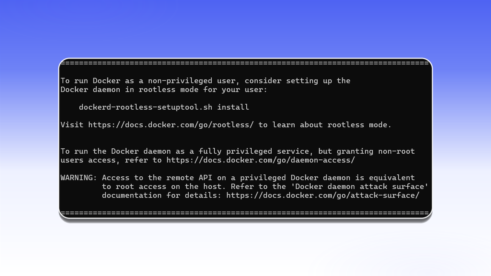
  </picture>
  <figcaption>安装结束时 Docker 安装程序的提示</figcaption>
</figure>

返回 ShardBrowser。在 <mark style="color:purple;">**Create a team**</mark> 窗口的 <mark style="color:purple;">**Docker**</mark> 选项卡中，已经生成了包含您团队名称的服务器启动命令。点击字段右侧的按钮复制该命令。

<figure>
  <picture>
    <source srcset="../../.gitbook/assets/shardbrowser-team-create-docker-command_black.png" media="(prefers-color-scheme: dark)">
    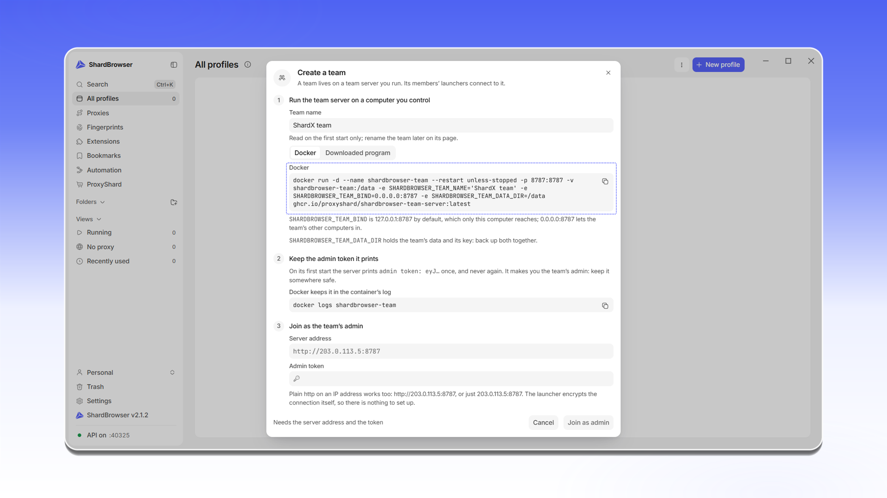
  </picture>
  <figcaption>在 Docker 选项卡中复制启动命令</figcaption>
</figure>


`SHARDBROWSER_TEAM_BIND` 默认为 `127.0.0.1:8787`，此时只能从本机连接服务器。要让其他成员连接，请在命令中保留 `0.0.0.0:8787`。

`SHARDBROWSER_TEAM_DATA_DIR` 是存放团队数据及其密钥的文件夹。请整体备份该文件夹。


在服务器上启用 Docker 开机自启，检查安装情况，然后运行复制的命令：

```bash
sudo systemctl enable docker
sudo systemctl start docker
sudo usermod -aG docker $USER
docker --version
docker compose version
```

```bash
docker run -d --name shardbrowser-team --restart unless-stopped -p 8787:8787 -v shardbrowser-team:/data -e SHARDBROWSER_TEAM_NAME='ShardX team' -e SHARDBROWSER_TEAM_BIND=0.0.0.0:8787 -e SHARDBROWSER_TEAM_DATA_DIR=/data ghcr.io/proxyshard/shardbrowser-team-server:latest
```

命令中的 `ShardX team` 会替换为您输入的名称。Docker 会拉取 `shardbrowser-team-server` 镜像并启动 `shardbrowser-team` 容器。由于使用了 `--restart unless-stopped`，VPS 重启后服务器会自动恢复运行。

<figure>
  <picture>
    <source srcset="../../.gitbook/assets/shardbrowser-team-vps-server-run_black.png" media="(prefers-color-scheme: dark)">
    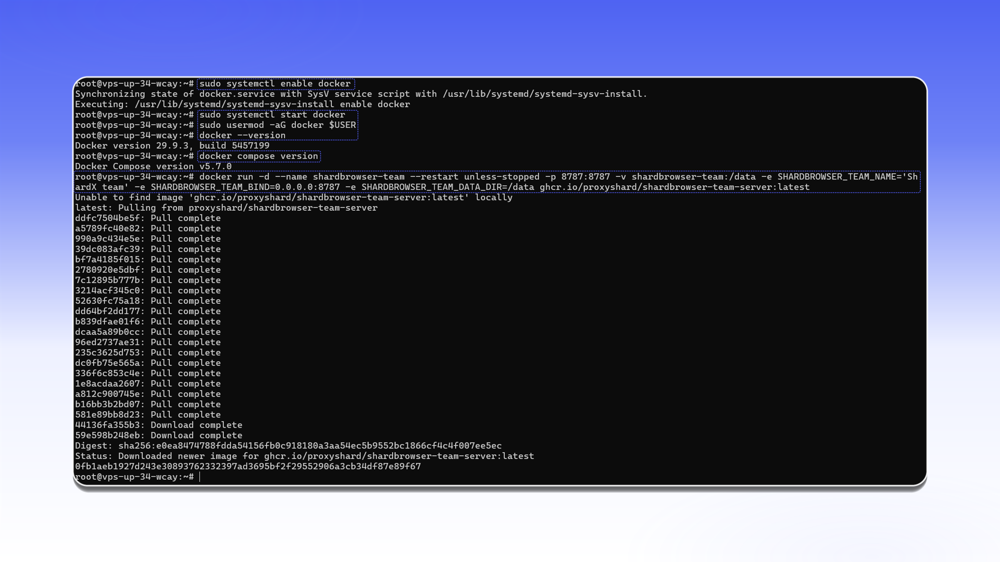
  </picture>
  <figcaption>启动团队服务器容器</figcaption>
</figure>

首次启动时，服务器会在日志中输出一次管理员令牌。使用以下命令查看：

```bash
docker logs shardbrowser-team
```

复制 <mark style="color:purple;">`admin token`</mark> 的值。日志中还包含 <mark style="color:purple;">`invite`</mark>（包含同一令牌的链接，请将 `0.0.0.0` 替换为服务器地址）以及启动器用于验证服务器的 <mark style="color:purple;">`public key`</mark>。

<figure>
  <picture>
    <source srcset="../../.gitbook/assets/shardbrowser-team-vps-admin-token_black.png" media="(prefers-color-scheme: dark)">
    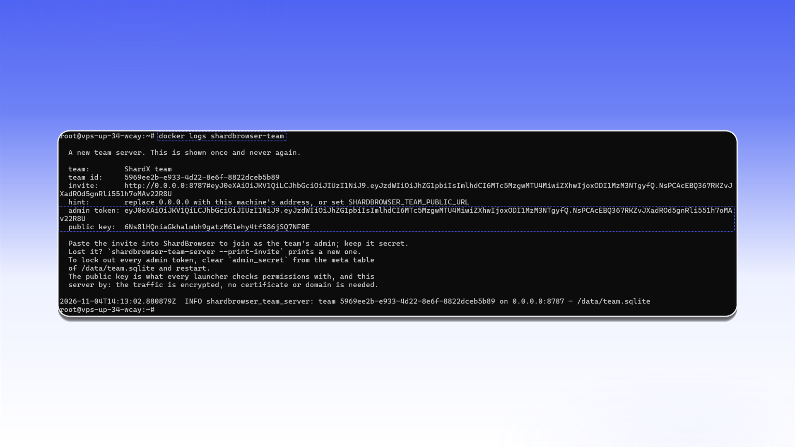
  </picture>
  <figcaption>容器日志中的管理员令牌</figcaption>
</figure>


管理员令牌仅在首次启动时显示，并拥有团队的完全访问权限。请将其保存在安全的地方，切勿分享给他人。如果令牌丢失，可使用 `shardbrowser-team-server --print-invite` 命令生成新的令牌。


---

## 以管理员身份加入团队

在 <mark style="color:purple;">**Create a team**</mark> 窗口的 <mark style="color:purple;">**Join as the team's admin**</mark> 区域中填写以下字段：

* <mark style="color:purple;">**Server address**</mark>：服务器的 IP 地址和端口，例如 `203.0.113.5:8787` 或 `http://203.0.113.5:8787`。无需域名或证书：启动器会自行加密连接。
* <mark style="color:purple;">**Admin token**</mark>：容器日志中的令牌。

点击 <mark style="color:purple;">**Join as admin**</mark>。

<figure>
  <picture>
    <source srcset="../../.gitbook/assets/shardbrowser-team-join-as-admin_black.png" media="(prefers-color-scheme: dark)">
    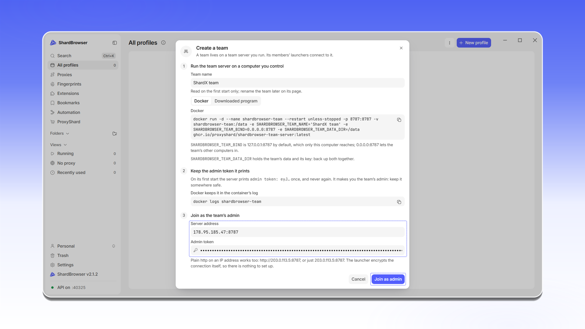
  </picture>
  <figcaption>输入服务器地址和管理员令牌</figcaption>
</figure>

团队页面随即打开。左下角的切换器中现在选中的是您的团队。在此模式下创建的配置文件存储在团队服务器上。<mark style="color:purple;">**Getting the team going**</mark> 区域提示了操作顺序：创建文件夹、创建配置文件、添加成员并为其分配权限。

<figure>
  <picture>
    <source srcset="../../.gitbook/assets/shardbrowser-team-page-empty_black.png" media="(prefers-color-scheme: dark)">
    
  </picture>
  <figcaption>新团队页面</figcaption>
</figure>

---

## 添加成员

点击 <mark style="color:purple;">**+ Add member**</mark>。

<figure>
  <picture>
    <source srcset="../../.gitbook/assets/shardbrowser-team-add-member-button_black.png" media="(prefers-color-scheme: dark)">
    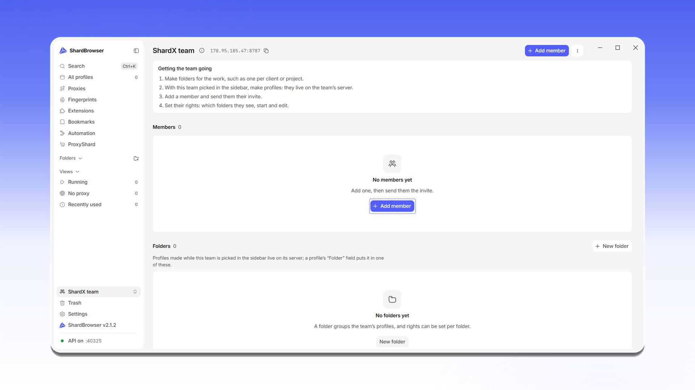
  </picture>
  <figcaption>Add member 按钮</figcaption>
</figure>

输入成员名称，然后点击 <mark style="color:purple;">**Add member**</mark>。

<figure>
  <picture>
    <source srcset="../../.gitbook/assets/shardbrowser-team-add-member-dialog_black.png" media="(prefers-color-scheme: dark)">
    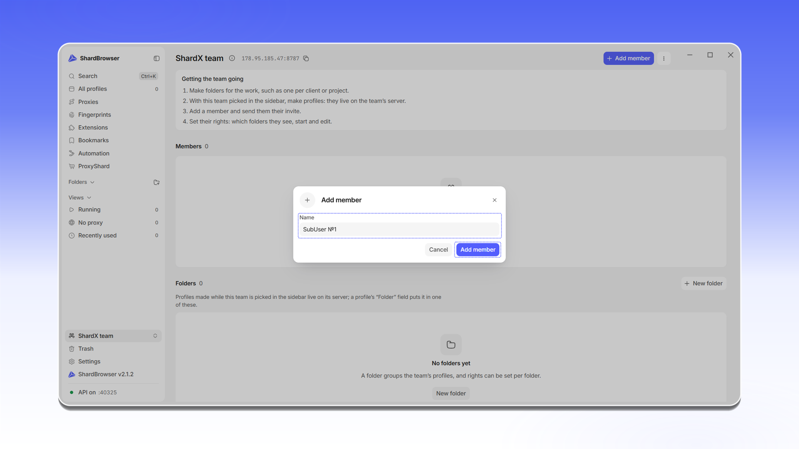
  </picture>
  <figcaption>新成员名称</figcaption>
</figure>

随后会显示该成员的邀请链接。复制并发送给成员：成员需要在 <mark style="color:purple;">**Join a team**</mark> 窗口中粘贴它。邀请链接仅显示一次，可以通过成员菜单中的 <mark style="color:purple;">**New invite...**</mark> 生成新的邀请。

在成员获得权限之前，团队对其显示为空。点击 <mark style="color:purple;">**Set rights...**</mark> 立即分配访问权限。

<figure>
  <picture>
    <source srcset="../../.gitbook/assets/shardbrowser-team-member-invite_black.png" media="(prefers-color-scheme: dark)">
    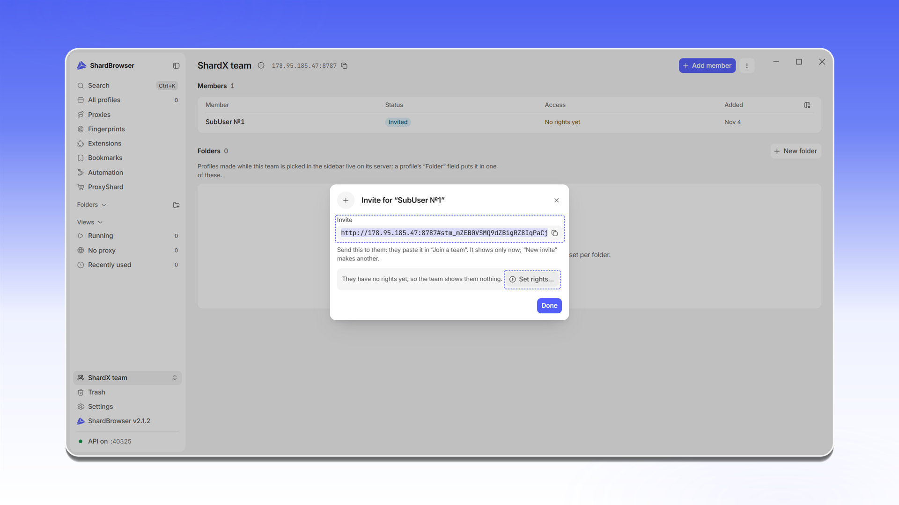
  </picture>
  <figcaption>成员邀请链接和 Set rights 按钮</figcaption>
</figure>

---

## 成员权限

在 <mark style="color:purple;">**Rights**</mark> 窗口中通过表格设置权限。点击单元格（或按 `Space` 键）可在未设置、允许（对勾）和拒绝（叉号）之间切换。规则重叠时，以范围最小的规则为准。

| 权限          | 允许的操作              |
| ------------ | ---------------------- |
| **See**      | 查看配置文件            |
| **Start**    | 启动配置文件            |
| **Edit**     | 编辑配置文件            |
| **Create**   | 创建配置文件            |
| **Delete**   | 删除配置文件            |
| **Cookies**  | 管理配置文件的 Cookies  |
| **Take out** | 将配置文件移出团队       |

为快速设置 <mark style="color:purple;">**Whole team**</mark> 行，提供了以下预设：<mark style="color:purple;">**None**</mark>、<mark style="color:purple;">**See only**</mark>、<mark style="color:purple;">**Start**</mark>、<mark style="color:purple;">**Edit**</mark> 和 <mark style="color:purple;">**All but take out**</mark>。也可以为团队的每个文件夹单独设置权限。点击 <mark style="color:purple;">**Save rights**</mark>。

<figure>
  <picture>
    <source srcset="../../.gitbook/assets/shardbrowser-team-member-rights_black.png" media="(prefers-color-scheme: dark)">
    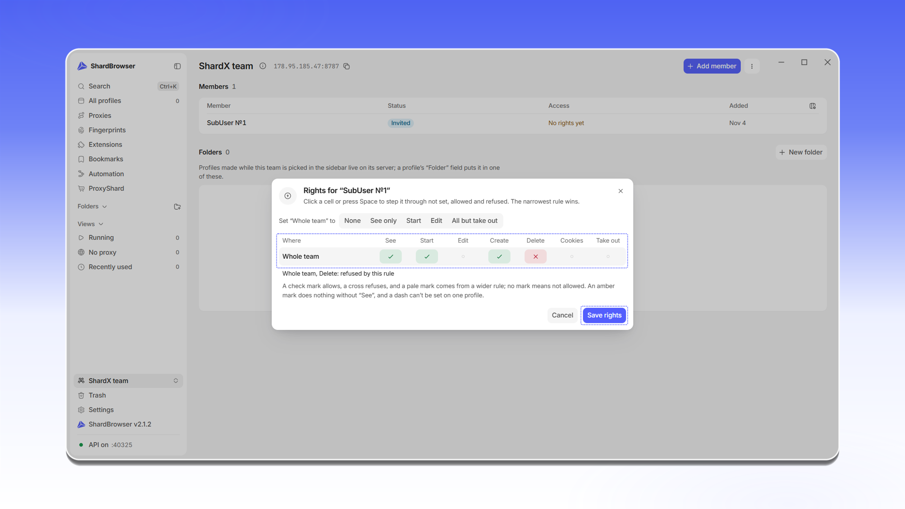
  </picture>
  <figcaption>成员对整个团队的权限</figcaption>
</figure>


没有 <mark style="color:purple;">**See**</mark> 权限时，其他权限不起作用：成员无法启动或编辑自己看不到的配置文件。


已分配的权限显示在 <mark style="color:purple;">**Access**</mark> 列中。在成员菜单（<mark style="color:purple;">**⋮**</mark>）中，可以修改权限（<mark style="color:purple;">**Rights...**</mark>）、暂时停用成员（<mark style="color:purple;">**Switch off**</mark>）、生成新的邀请（<mark style="color:purple;">**New invite...**</mark>）或将成员移出团队（<mark style="color:purple;">**Remove...**</mark>）。

<figure>
  <picture>
    <source srcset="../../.gitbook/assets/shardbrowser-team-member-menu_black.png" media="(prefers-color-scheme: dark)">
    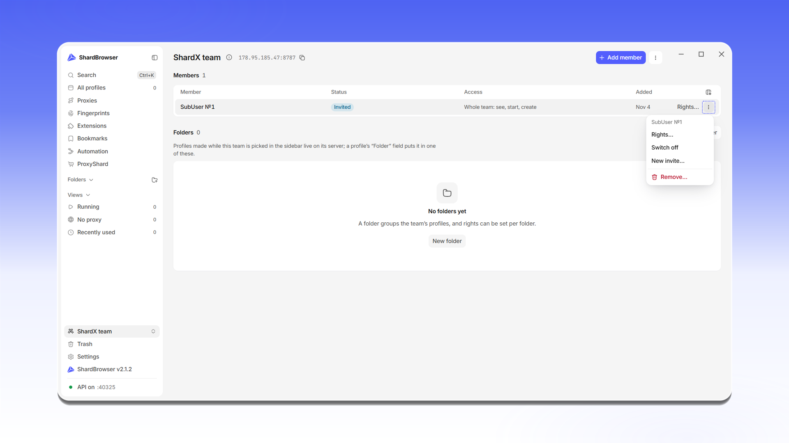
  </picture>
  <figcaption>成员菜单</figcaption>
</figure>

---

## 团队文件夹和配置文件

在团队页面点击 <mark style="color:purple;">**+ New folder**</mark> 按钮即可创建团队文件夹，它们会像普通文件夹一样显示在侧边菜单中。新配置文件会放入其 <mark style="color:purple;">**Folder**</mark> 字段中指定的文件夹。

左下角的工作空间切换器显示您当前的工作位置：<mark style="color:purple;">**Personal**</mark>（本地配置文件）或某个团队（旁边显示其服务器地址）。管理员可以通过此菜单打开团队页面（<mark style="color:purple;">**Manage team**</mark>），也可以加入其他团队、创建新团队或退出当前团队（<mark style="color:purple;">**Leave this team...**</mark>）。

<figure>
  <picture>
    <source srcset="../../.gitbook/assets/shardbrowser-team-manage-team-menu_black.png" media="(prefers-color-scheme: dark)">
    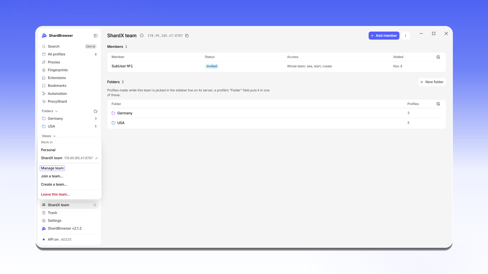
  </picture>
  <figcaption>团队文件夹和 Manage team 菜单</figcaption>
</figure>

---

## 成员加入团队

成员打开 ShardBrowser，点击切换器 <mark style="color:purple;">**Personal**</mark>，然后选择 <mark style="color:purple;">**Join a team...**</mark>。

<figure>
  <picture>
    <source srcset="../../.gitbook/assets/shardbrowser-team-join-menu_black.png" media="(prefers-color-scheme: dark)">
    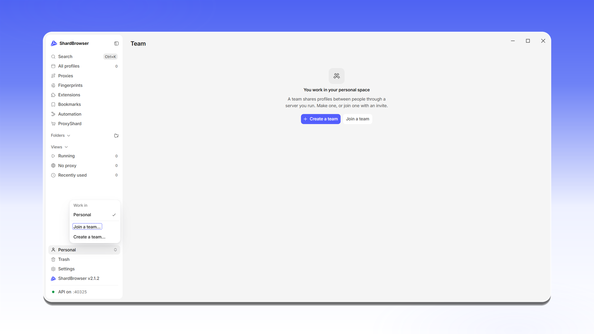
  </picture>
  <figcaption>工作空间菜单："Join a team..."</figcaption>
</figure>

在 <mark style="color:purple;">**Join a team**</mark> 窗口中，将管理员发送的邀请链接粘贴到 <mark style="color:purple;">**Invite or server address**</mark> 字段中。服务器地址和 <mark style="color:purple;">**Access token**</mark> 会自动填写。然后点击 <mark style="color:purple;">**Join**</mark>。

<figure>
  <picture>
    <source srcset="../../.gitbook/assets/shardbrowser-team-join-dialog_black.png" media="(prefers-color-scheme: dark)">
    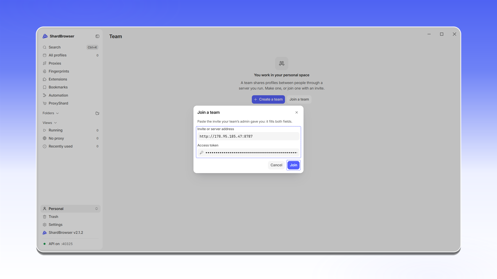
  </picture>
  <figcaption>在 Join a team 窗口中粘贴邀请链接</figcaption>
</figure>

加入后，成员的切换器菜单中会出现 <mark style="color:purple;">**Your access**</mark> 项。它显示管理员分配的权限，只有管理员可以修改。

<figure>
  <picture>
    <source srcset="../../.gitbook/assets/shardbrowser-team-your-access_black.png" media="(prefers-color-scheme: dark)">
    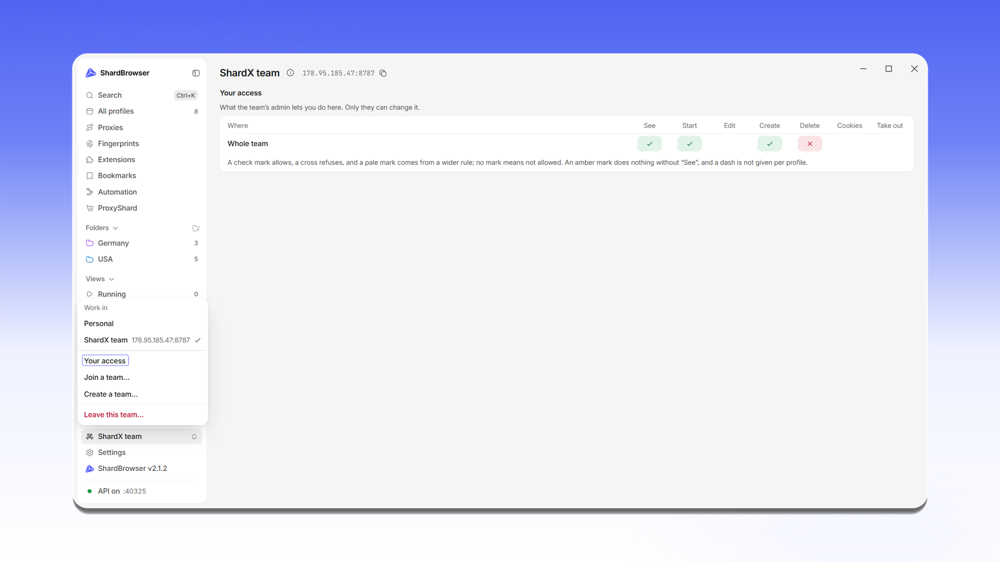
  </picture>
  <figcaption>Your access 中的成员权限</figcaption>
</figure>

在 <mark style="color:purple;">**All profiles**</mark> 中，成员可以看到其有权访问的文件夹中的团队配置文件，并在已分配的权限范围内使用它们。要返回本地配置文件，请在切换器中选择 <mark style="color:purple;">**Personal**</mark>。

<figure>
  <picture>
    <source srcset="../../.gitbook/assets/shardbrowser-team-profiles_black.png" media="(prefers-color-scheme: dark)">
    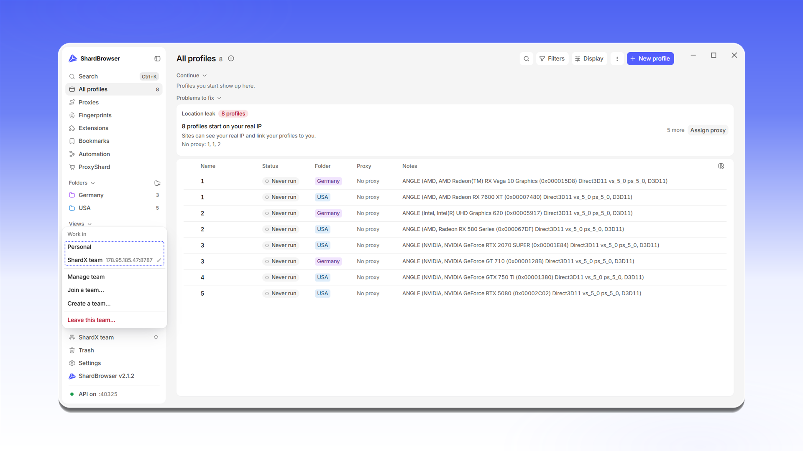
  </picture>
  <figcaption>成员端的团队配置文件</figcaption>
</figure>
