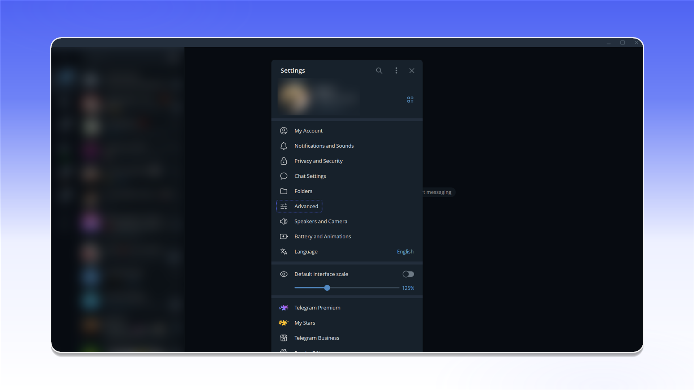
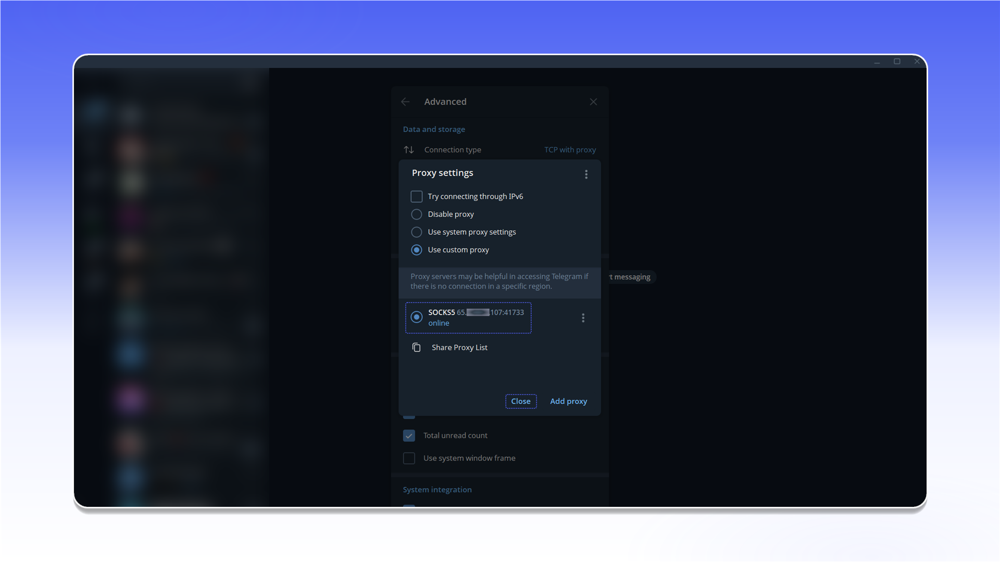

# Telegram

## Telegram Desktop

打开 `Settings`。

<figure>
  <picture>
    <source srcset="../.gitbook/assets/telegram-desktop-menu-settings_black.png" media="(prefers-color-scheme: dark)">
    
  </picture>
</figure>

进入 `Advanced`。

<figure>
  <picture>
    <source srcset="../.gitbook/assets/telegram-desktop-settings-advanced_black.png" media="(prefers-color-scheme: dark)">
    
  </picture>
</figure>

在 `Network and proxy` 中打开 `Connection type`。

<figure>
  <picture>
    <source srcset="../.gitbook/assets/telegram-desktop-connection-type_black.png" media="(prefers-color-scheme: dark)">
    
  </picture>
</figure>

选择 `Use custom proxy`，点击 `Add proxy`，然后选择协议。使用订单 `Proxy List` 中的数据填写地址、端口、用户名和密码。


数据格式和订单示例请参阅[开始使用](getting-started.md)。


<figure>
  <picture>
    <source srcset="../.gitbook/assets/telegram-desktop-use-custom-proxy_black.png" media="(prefers-color-scheme: dark)">
    
  </picture>
</figure>

保存设置，并确认代理旁显示 `Connected` 状态。

<figure>
  <picture>
    <source srcset="../.gitbook/assets/telegram-desktop-proxy-connected_black.png" media="(prefers-color-scheme: dark)">
    
  </picture>
</figure>

## iOS 版 Telegram

打开 `Settings`，选择 `Data and Storage`。

<figure>
  <picture>
    <source srcset="../.gitbook/assets/telegram-ios-settings-data-storage_black.png" media="(prefers-color-scheme: dark)">
    
  </picture>
</figure>

打开 `Proxy`，然后点击 `Add Proxy`。

<figure>
  <picture>
    <source srcset="../.gitbook/assets/telegram-ios-connection-proxy_black.png" media="(prefers-color-scheme: dark)">
    
  </picture>
</figure>

选择 `SOCKS5`，并使用订单 `Proxy List` 中的数据填写 `Server`、`Port`、`Username` 和 `Password`。

<figure>
  <picture>
    <source srcset="../.gitbook/assets/telegram-ios-proxy-socks5-form_black.png" media="(prefers-color-scheme: dark)">
    
  </picture>
</figure>

保存设置，然后启用刚才创建的代理。
