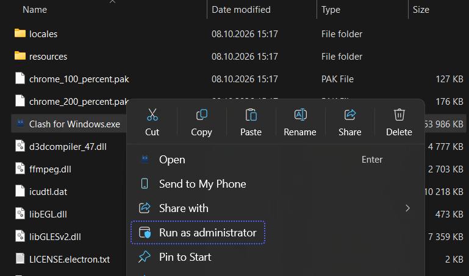
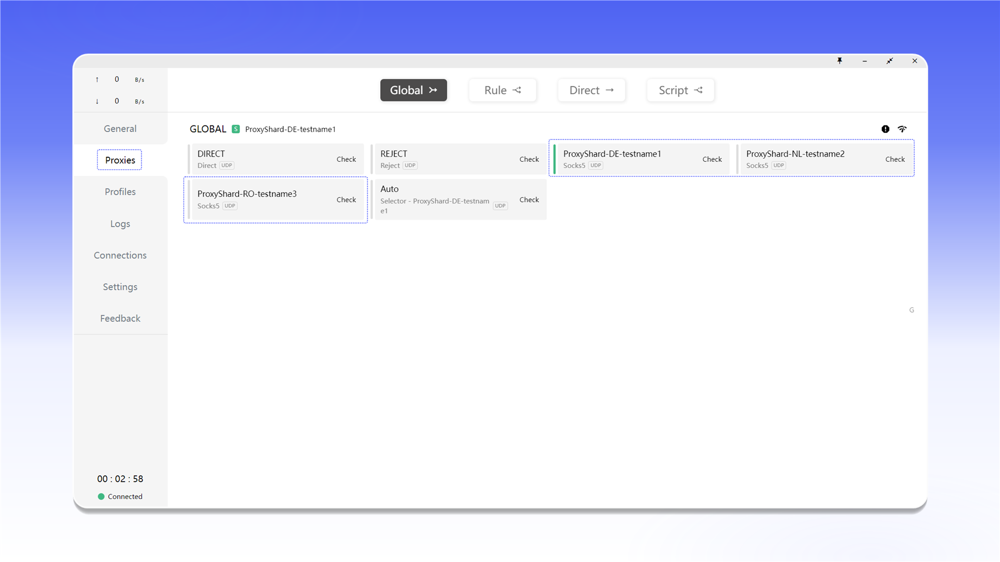
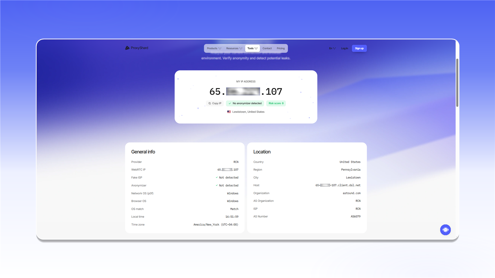

# Clash for Windows


Clash for Windows 可在 TUN 模式下代理 TCP 和 UDP 流量。


## 下载并启动

打开 [Clash for Windows 发布页面](https://github.com/lantongxue/clash_for_windows_pkg/releases)，下载 `Clash.for.Windows-0.20.39-win.7z`。

<figure>
  <picture>
    <source srcset="../../.gitbook/assets/clashx-github-download_black.png" media="(prefers-color-scheme: dark)">
    
  </picture>
</figure>

将压缩包解压到单独的文件夹。

<figure><figcaption></figcaption></figure>

以管理员身份运行 `Clash for Windows.exe`。安装和运行系统网络驱动需要管理员权限。

<figure><figcaption></figcaption></figure>

## 配置文件

1. 打开 `Profiles`。
2. 点击 `config.yaml` 旁边的 `<>` 图标。

<figure>
  <picture>
    <source srcset="../../.gitbook/assets/clashx-profiles-edit-config_black.png" media="(prefers-color-scheme: dark)">
    
  </picture>
</figure>

在 `proxies:` 中添加代理，并填写订单中的连接信息。以下示例使用 SOCKS5。

```yaml
proxies:
  - name: "ShardX-Germany"
    type: socks5
    server: 123.123.123.123
    port: 41733
    username: proxy_login
    password: proxy_password
    udp: true

proxy-groups:
  - name: "ShardX"
    type: select
    proxies:
      - ShardX-Germany

rules:
  - PROCESS-NAME,chrome.exe,ShardX
  - MATCH,DIRECT
```

`name` 是连接名称。在 `server`、`port`、`username` 和 `password` 中填写代理信息。`udp: true` 用于启用该服务器的 UDP。

<figure>
  <picture>
    <source srcset="../../.gitbook/assets/clashx-profile-config-proxies_black.png" media="(prefers-color-scheme: dark)">
    
  </picture>
</figure>


如需了解连接信息的位置，请参阅[通用配置说明](../getting-started.md)。


## 启用并检测代理

1. 打开 `Proxies`。
2. 选择 `Global` 模式。
3. 点击 ShardX 服务器旁边的 `Check`。

<figure>
  <picture>
    <source srcset="../../.gitbook/assets/clashx-proxies-global-select_black.png" media="(prefers-color-scheme: dark)">
    
  </picture>
</figure>

如果连接可用，服务器卡片会显示延迟。

<figure><figcaption></figcaption></figure>

## 添加多个代理

在 `proxies:` 中将每个服务器添加为独立项目，并在 `ShardX` 组中列出其名称。保存后，可在 `Proxies` 中切换服务器。

<figure>
  <picture>
    <source srcset="../../.gitbook/assets/clashx-proxies-multiple-list_black.png" media="(prefers-color-scheme: dark)">
    
  </picture>
</figure>

## 启用 TUN Mode

1. 打开 `General`。
2. 在 `TAP Device` 行中点击 `Manage`，然后点击 `Install`。
3. 启用 `TUN Mode`，使系统流量通过所选代理传输。

<figure>
  <picture>
    <source srcset="../../.gitbook/assets/clashx-general-tap-tun-setup_black.png" media="(prefers-color-scheme: dark)">
    
  </picture>
</figure>

## 验证连接

打开 [ShardX IP Checker](https://proxyshard.com/ip-checker)，确认页面显示代理 IP 地址。

<figure>
  <picture>
    <source srcset="../../.gitbook/assets/clashx-ip-checker-result_black.png" media="(prefers-color-scheme: dark)">
    
  </picture>
</figure>

还可以使用 BrowserLeaks 检查 WebRTC 泄漏。

<figure>
  <picture>
    <source srcset="../../.gitbook/assets/clashx-browserleaks-check_black.png" media="(prefers-color-scheme: dark)">
    
  </picture>
</figure>

如果连接失败，请检查 `config.yaml` 中的数据，以管理员身份重新启动程序，并参阅[故障排除说明](../../faq-and-support/faq/proxy-not-working.md)。
