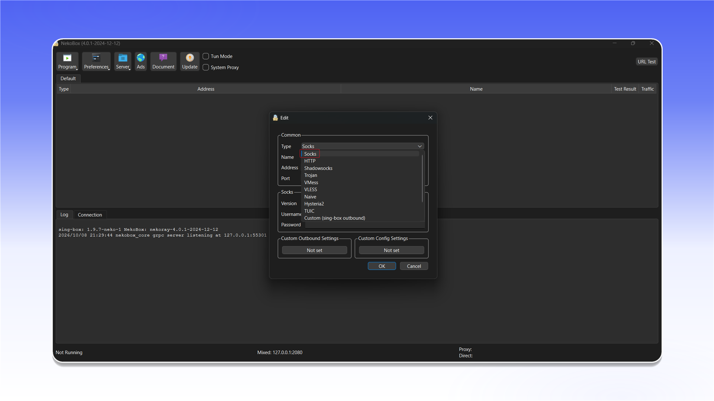

# NekoRay


NekoRay 可在 TUN 模式下代理 TCP 和 UDP 流量。


## 下载并启动

从 [NekoRay 发布页面](https://github.com/MatsuriDayo/nekoray/releases)下载 Windows 压缩包，解压后运行 `nekoray.exe` 或 `nekobox.exe`。首次启动时选择 `sing-box` 内核。

<figure>
  <picture>
    <source srcset="../../.gitbook/assets/nekoray-github-download_black.png" media="(prefers-color-scheme: dark)">
    
  </picture>
</figure>

## 创建配置

在服务器列表的空白区域单击右键，然后选择 `New profile`。

<figure>
  <picture>
    <source srcset="../../.gitbook/assets/nekoray-main-new-profile_black.png" media="(prefers-color-scheme: dark)">
    
  </picture>
</figure>

在 `Type` 列表中选择 `Socks`。

<figure>
  <picture>
    <source srcset="../../.gitbook/assets/nekoray-profile-type-socks_black.png" media="(prefers-color-scheme: dark)">
    
  </picture>
</figure>

填写连接信息：

1. 在 `Name` 中输入便于识别的名称。
2. 在 `Address` 和 `Port` 中输入代理地址和端口。
3. 在 `Socks` 部分选择 `Version: 5`。
4. 填写 `Username` 和 `Password`。
5. 点击 `OK`。

<figure>
  <picture>
    <source srcset="../../.gitbook/assets/nekoray-profile-config_black.png" media="(prefers-color-scheme: dark)">
    
  </picture>
</figure>


如需了解连接信息的位置，请参阅[通用配置说明](../getting-started.md)。


## 连接

选择已创建的配置，并在顶部工具栏中启用 `Tun Mode`。连接后，系统流量将通过该代理传输。

<figure>
  <picture>
    <source srcset="../../.gitbook/assets/nekoray-tun-mode-enable_black.png" media="(prefers-color-scheme: dark)">
    
  </picture>
</figure>
