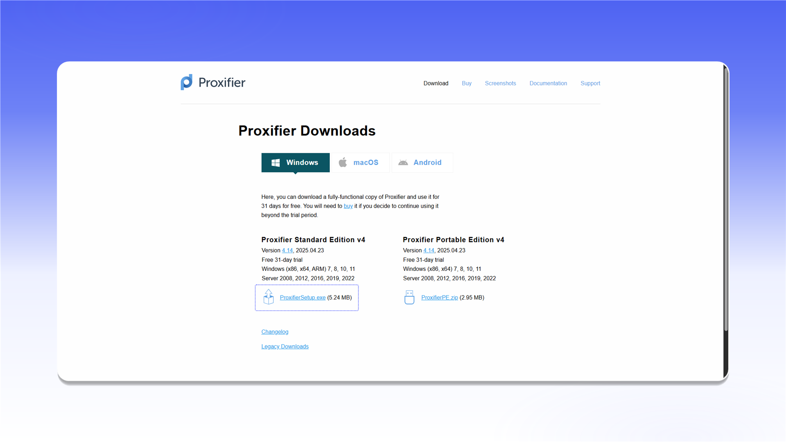

# Proxifier


Proxifier 不支持 UDP 代理。



Proxifier 是付费软件，提供 31 天试用期。


## 安装

打开 [Proxifier 下载页面](https://www.proxifier.com/download/)，下载 `ProxifierSetup.exe` 并完成安装。

<figure>
  <picture>
    <source srcset="../../.gitbook/assets/proxifier-website-download_black.png" media="(prefers-color-scheme: dark)">
    
  </picture>
</figure>

## 添加代理

1. 启动 Proxifier。
2. 打开 `Profile` 菜单并选择 `Proxy Servers...`。

<figure>
  <picture>
    <source srcset="../../.gitbook/assets/proxifier-menu-proxy-servers_black.png" media="(prefers-color-scheme: dark)">
    
  </picture>
</figure>

在 `Proxy Servers` 窗口中点击 `Add...`，然后填写以下信息：

- `Address`：代理 IP 地址或域名；
- `Port`：连接端口；
- `Protocol`：选择 `SOCKS Version 5`，HTTP 代理则选择 `HTTPS`；
- `Authentication`：启用 `Enable`，然后填写 `Username` 和 `Password`。

<figure>
  <picture>
    <source srcset="../../.gitbook/assets/proxifier-add-proxy-dialog_black.png" media="(prefers-color-scheme: dark)">
    
  </picture>
</figure>


如需了解连接信息的位置，请参阅[通用配置说明](../getting-started.md)。


点击 `Check`。出现 `Proxy is ready to work with Proxifier!` 后，点击 `OK` 关闭检测窗口并保存服务器。

<figure>
  <picture>
    <source srcset="../../.gitbook/assets/proxifier-proxy-check-success_black.png" media="(prefers-color-scheme: dark)">
    
  </picture>
</figure>

## 配置路由规则

打开 `Profile` 菜单并选择 `Proxification Rules...`。

<figure>
  <picture>
    <source srcset="../../.gitbook/assets/proxifier-menu-proxification-rules_black.png" media="(prefers-color-scheme: dark)">
    
  </picture>
</figure>

在 `Default` 行的 `Action` 列中选择已添加的 SOCKS5 代理，然后点击 `OK`。应用流量将通过所选服务器传输。

<figure>
  <picture>
    <source srcset="../../.gitbook/assets/proxifier-rules-configuration_black.png" media="(prefers-color-scheme: dark)">
    
  </picture>
</figure>
