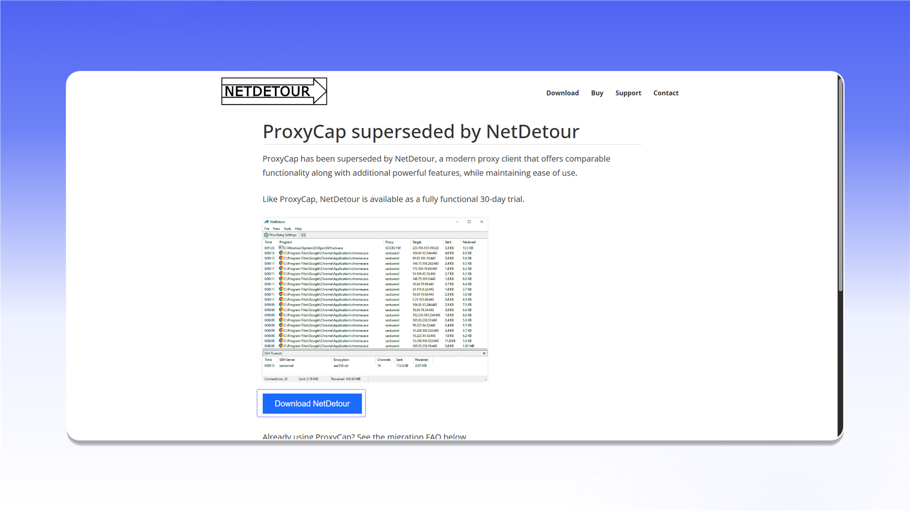
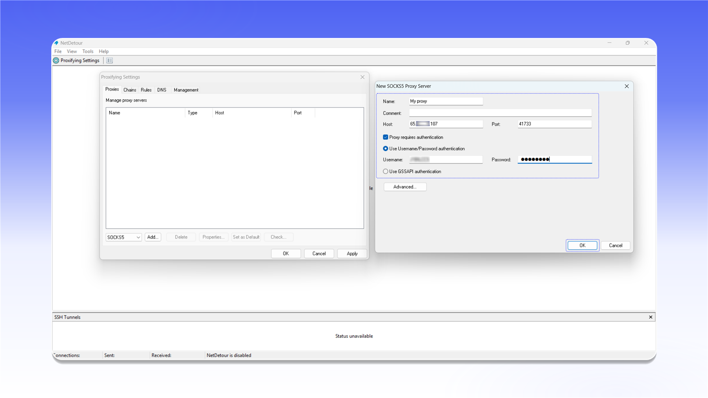

# ProxyCap (NetDetour)


NetDetour 支持 TCP 和 UDP 代理。



NetDetour 是 ProxyCap 的后续版本。该软件为付费软件，提供 30 天试用期。


## 安装

打开[下载页面](https://www.proxycap.com/download.html)，点击 `Download NetDetour` 并完成安装。

<figure>
  <picture>
    <source srcset="../../.gitbook/assets/proxycap-netdetour-website-download_black.png" media="(prefers-color-scheme: dark)">
    
  </picture>
</figure>

## 添加代理

1. 点击顶部工具栏中的 `Proxifying Settings` 图标。
2. 打开 `Proxies` 选项卡。
3. 选择 `SOCKS5`，然后点击 `Add...`。

<figure>
  <picture>
    <source srcset="../../.gitbook/assets/proxycap-netdetour-settings-add-proxy_black.png" media="(prefers-color-scheme: dark)">
    
  </picture>
</figure>

填写 `New SOCKS5 Proxy Server` 表单：

- `Name`：便于识别的名称；
- `Host`：代理 IP 地址或域名；
- `Port`：连接端口；
- `Proxy requires authentication`：启用此选项；
- `Use Username/Password authentication`：填写用户名和密码。

点击 `OK` 保存服务器。

<figure>
  <picture>
    <source srcset="../../.gitbook/assets/proxycap-netdetour-proxy-server-config_black.png" media="(prefers-color-scheme: dark)">
    
  </picture>
</figure>


如需了解连接信息的位置，请参阅[通用配置说明](../getting-started.md)。


## 创建规则

1. 在 `Proxifying Settings` 中打开 `Rules` 选项卡。
2. 点击 `New...`。
3. 在 `Rule Action` 步骤中选择 `Tunnel through proxy`。
4. 在 `Proxy` 列表中选择已添加的连接。
5. 点击 `Next >`，选择所需应用，或将规则应用于所有程序，然后保存。

<figure>
  <picture>
    <source srcset="../../.gitbook/assets/proxycap-netdetour-rule-action-wizard_black.png" media="(prefers-color-scheme: dark)">
    
  </picture>
</figure>
