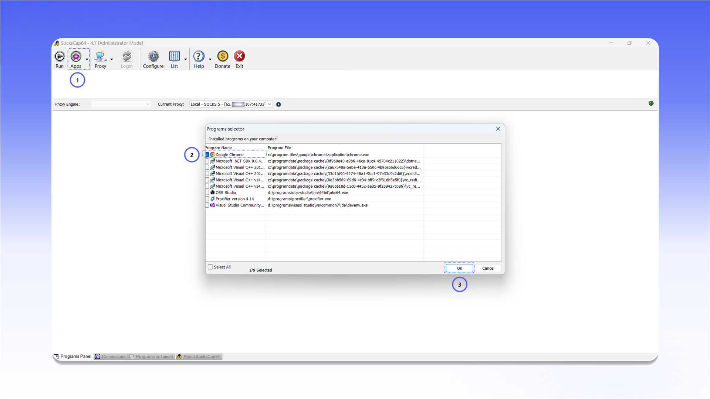

# SocksCap64


SocksCap64 支持 TCP 和 UDP 代理。


## 安装

从[发布页面](https://github.com/bobo2334/sockscap64/releases/tag/4.7)下载 `SocksCap64-setup-4.7.exe`，完成安装后以管理员身份运行 SocksCap64。

<figure>
  <picture>
    <source srcset="../../.gitbook/assets/sockscap64-github-download_black.png" media="(prefers-color-scheme: dark)">
    
  </picture>
</figure>

## 添加代理

1. 点击顶部工具栏中的 `Proxy`。
2. 在 `Proxy Manager` 窗口中点击 `+`。
3. 填写连接信息：
   - `Proxy Address`：服务器 IP 地址或域名；
   - `Port`：连接端口；
   - `Account`：用户名；
   - `Password`：密码；
   - `SOCKS Type`：选择 `SOCKS 5`。
4. 点击 `Save`。

<figure>
  <picture>
    <source srcset="../../.gitbook/assets/sockscap64-proxy-manager-config_black.png" media="(prefers-color-scheme: dark)">
    
  </picture>
</figure>


如需了解连接信息的位置，请参阅[通用配置说明](../getting-started.md)。


## 添加应用

点击 `Apps`，在 `Programs selector` 中选择需要的应用，然后点击 `OK`。

<figure>
  <picture>
    <source srcset="../../.gitbook/assets/sockscap64-programs-selector-add_black.png" media="(prefers-color-scheme: dark)">
    
  </picture>
</figure>

## 通过代理运行

右键单击已添加的应用，选择 `Run selected program in tunnel`。应用将通过配置的 SOCKS5 代理启动。

<figure>
  <picture>
    <source srcset="../../.gitbook/assets/sockscap64-run-program-in-tunnel_black.png" media="(prefers-color-scheme: dark)">
    
  </picture>
</figure>
