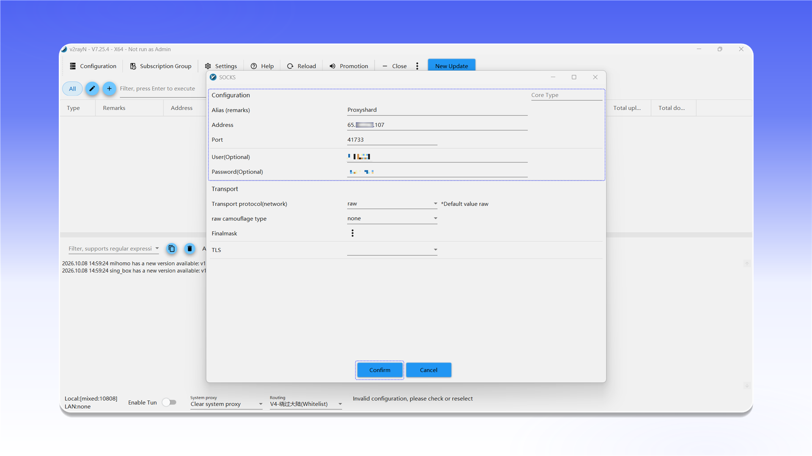

# v2rayN


v2rayN 可在 TUN 模式下代理 TCP 和 UDP 流量。


## 下载并启动

打开 [v2rayN 最新版本页面](https://github.com/2dust/v2rayN/releases/latest)，下载 `v2rayN-windows-64.zip`，解压后以管理员身份运行 `v2rayN.exe`。

<figure>
  <picture>
    <source srcset="../../.gitbook/assets/v2rayn-github-download_black.png" media="(prefers-color-scheme: dark)">
    
  </picture>
</figure>

## 添加 SOCKS 服务器

打开 `Configuration` 菜单，然后选择 `Add [SOCKS]`。

<figure>
  <picture>
    <source srcset="../../.gitbook/assets/v2rayn-menu-add-socks_black.png" media="(prefers-color-scheme: dark)">
    
  </picture>
</figure>

填写连接信息：

- `Alias (remarks)`：便于识别的名称；
- `Address`：代理 IP 地址或域名；
- `Port`：连接端口；
- `User(Optional)`：用户名；
- `Password(Optional)`：密码。

点击 `Confirm` 保存配置。

<figure>
  <picture>
    <source srcset="../../.gitbook/assets/v2rayn-socks-config-dialog_black.png" media="(prefers-color-scheme: dark)">
    
  </picture>
</figure>


如需了解连接信息的位置，请参阅[通用配置说明](../getting-started.md)。


## 连接

选择已创建的服务器并测试延迟，然后在底部工具栏中启用 `Enable Tun`，使系统流量通过代理传输。

<figure>
  <picture>
    <source srcset="../../.gitbook/assets/v2rayn-enable-tun-mode_black.png" media="(prefers-color-scheme: dark)">
    
  </picture>
</figure>
