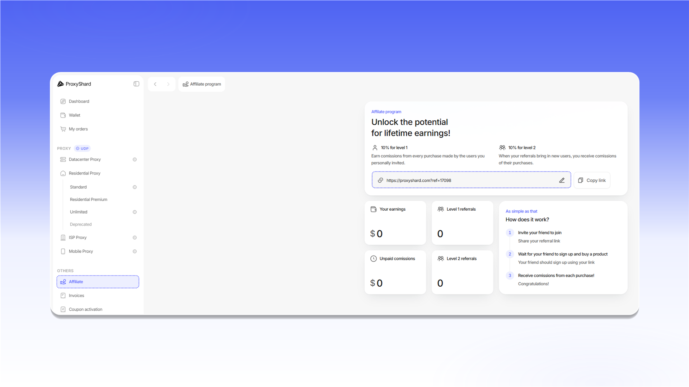

# 推荐计划

`Affiliate` 页面包含您的专属推荐链接。点击 `Copy link` 后，即可将链接发送给要邀请的用户。

您邀请的用户产生购买时，您可获得 10% 的一级佣金。

二级佣金仅面向有影响力的内容创作者、大型团队以及拥有自有媒体资源的其他合作伙伴开放。启用后，您可从一级推荐用户所邀请客户的购买中获得一定比例的佣金，具体比例将单独确定。如对二级佣金有任何疑问，请通过 `Live Chat` 联系我们。我们很乐意为您提供帮助。

如需自定义推荐链接末尾的内容，请点击链接旁边的铅笔图标并保存新值。此页面还会显示收益、未支付佣金以及各级推荐人数。

<figure>
  <picture>
    <source srcset="../.gitbook/assets/affiliate-program_black.png" media="(prefers-color-scheme: dark)">
    
  </picture>
</figure>


技术支持不会提供有关推荐链接访问记录或佣金计算的额外明细。


